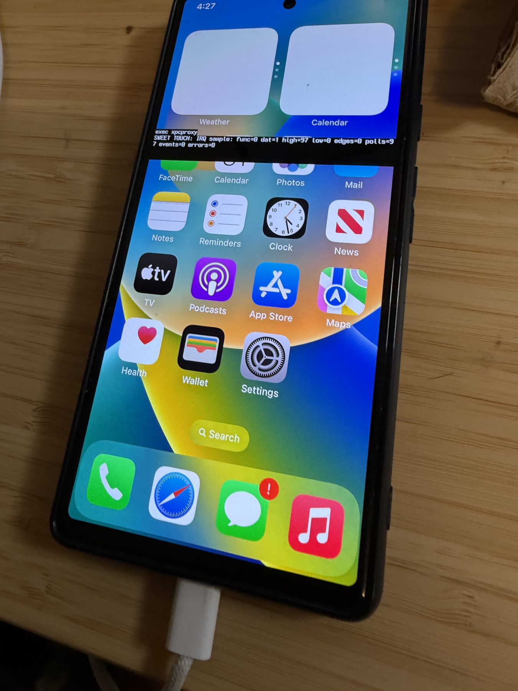
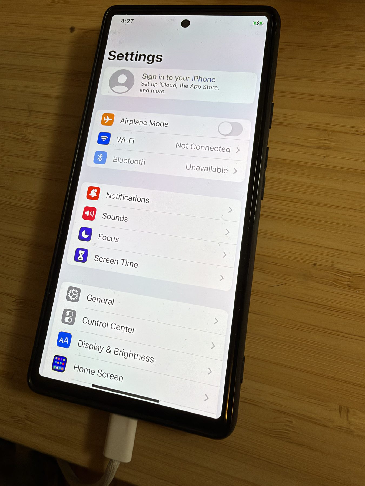
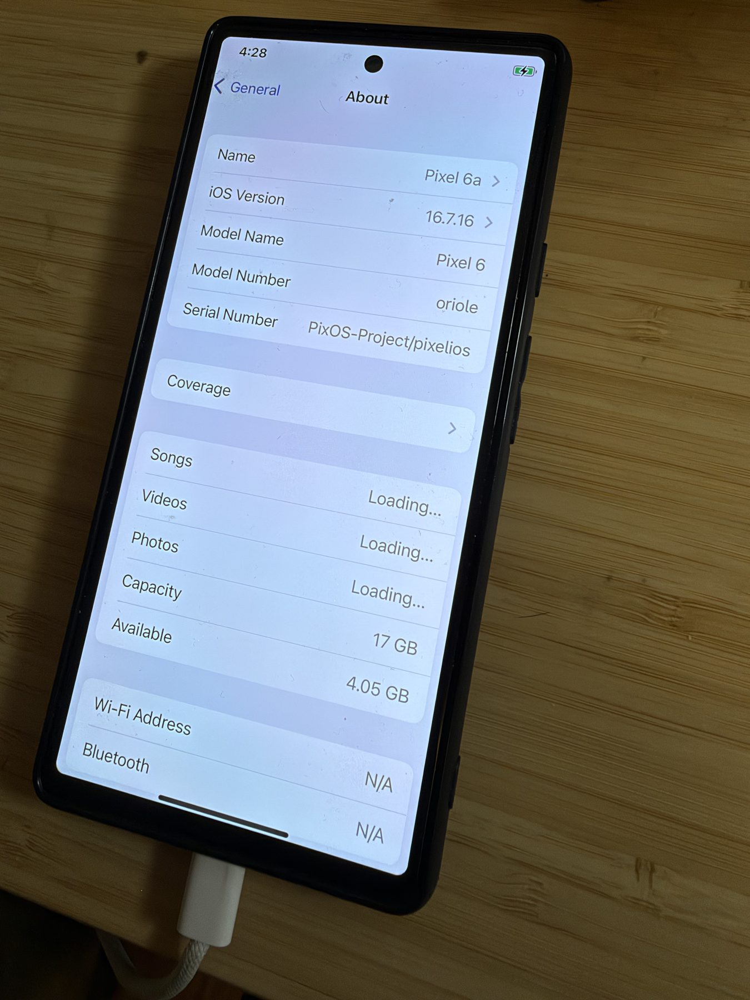
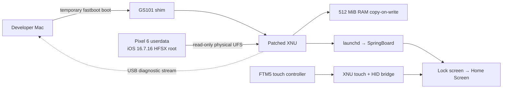

# iOS on Pixel 6

**An experimental iOS 16 port for the Google Pixel 6 (`oriole`).** On one physical device, the port booted XNU, mounted an iOS root volume, reached the lock screen, and used touch to swipe into the Home Screen, open apps, and navigate through Settings to About. It runs **extremely slowly** and is **not a public installer or a daily-use OS**. This curiosity-driven research phase is now paused after its first milestone; there is no identified practical use case or active product roadmap. A central question was how far AI-assisted engineering could take a hardware port.

[Project site](https://xnu.app/pixel6ios/) · [Milestone 1 record](docs/MILESTONE-ONE.md) · [Milestone 1 release](https://github.com/everettjf/pixel6ios/releases/tag/v0.1.0-alpha.2) · [Installation status](docs/INSTALLATION-STATUS.md)



*Tester-supplied photo of the physical Pixel 6. The black bar is a diagnostic text overlay from the test build. This is an observed interface, not evidence that every app or service works.*

## Why this experiment happened

The maintainer saw a number of posts on X claiming that iOS had been installed on Android phones and wanted to investigate the idea firsthand. A spare Pixel 6 made physical testing possible. Over several days, Codex helped explore the port, write and review code, analyze logs, and iterate on device tests, consuming a substantial token budget. The result is interesting as a research milestone, but it takes minutes to boot, taps and animations are slow, and Safari still shows a blank page for `google.com`. The cause of the poor performance has not been isolated; device age and incomplete optimization are possibilities, not established explanations.

## Milestone 1 · October 29–30, 2026

| Area | Verified result | Current limit |
| :--- | :--- | :--- |
| Boot | A temporary `fastboot boot` image starts the GS101 shim and patched XNU. | Normal power-on does not automatically start iOS. |
| System | XNU mounts the iOS 16.7.16 HFSX root volume; `launchd`, `backboardd`, and SpringBoard run. | The root image and some pinned build inputs cannot be redistributed here. |
| Display | Lock screen, Home Screen, Settings, and Settings → General → About were photographed on the physical Pixel 6. | The tested build can draw debug text over the interface; transitions are visibly slow. |
| Input | FTM5 touch events reach XNU HID; the tester swiped up from the lock screen, opened apps by tapping, and navigated into Settings and About. | Responsiveness is very poor. Other gestures, multitouch, sleep/wake, and long-term reliability are not validated. |
| Network | USB logging and a local host/device link have been exercised. Safari opens. | The content area stayed blank at `google.com`; public Internet access is unverified. |

The result is specific to **one Pixel 6** and the recorded firmware/build configuration. The `v0.1.0-alpha.2` prerelease captured the initial milestone; the later photographs and final research status are on `main`. The About screen's editable device *Name* says “Pixel 6a”, but its *Model Name* is “Pixel 6” and its *Model Number* is `oriole`; this is not a Pixel 6a compatibility claim.

### Photographic evidence

These are compressed, metadata-stripped copies of photographs supplied by the tester on October 30. The originals remain with the tester. Some photos deliberately show the debug overlay or an in-progress transition.

<p align="center">
  
  
  
</p>

*Left to right: Home Screen with a live debug bar; Settings; Settings → General → About. These are photographs of one experimental device, not app-compatibility or performance claims.*

| Observation | Photograph |
| :--- | :--- |
| Home Screen with live diagnostic overlay | [Home Screen](web/assets/gallery/pixel6-home-debug.jpg) |
| Slow Home Screen transition | [Transition](web/assets/gallery/pixel6-home-transition.jpg) |
| Settings opened by touch | [Settings](web/assets/gallery/pixel6-settings.jpg) · [with overlay](web/assets/gallery/pixel6-settings-debug.jpg) |
| Settings → General → About | [About](web/assets/gallery/pixel6-about.jpg) |
| Diagnostic text across the display | [Diagnostics](web/assets/gallery/pixel6-diagnostics.jpg) |
| Safari at `google.com` with a blank content area | [Safari](web/assets/gallery/pixel6-safari-blank.jpg) |

## How it fits together



The userland baseline is iPhone X iOS 16.7.16 (20H392); the kernel is a port of open-source XNU 8796.141.3 with GS101-specific work. The Apple root image, firmware, raw device logs, and private build inputs are **not** committed. The experimental configuration reads physical UFS without writing it; runtime writes go to a volatile RAM copy-on-write layer. Preparing the `userdata` partition for this experiment erased its previous Android data. An ordinary reboot may lead to Android Recovery because Android cannot use that partition as its own data volume.

## Build and installation status

This repository is for source review and research. **Do not treat it as an install guide.** A fresh public clone cannot reproduce the tested image: the current local relink path uses pinned inputs under ignored `private/`, and the iOS root builder is not integrated as a public, verified workflow. There is no one-click installer, distributable iOS image, supported-device matrix, or independently tested recovery procedure.

For developers with the documented local inputs, the quality gate is:

```sh
research/pixelios-kernel/tools/check-all.sh
```

The local image builder, `tools/build-oriole-fbsnap-local.sh`, only creates an image; it does not contact a phone. Device work requires separate identity, firmware, image-hash, and recovery checks. See the [installation status and remaining gates](docs/INSTALLATION-STATUS.md) before attempting any hardware operation.

## Research status and remaining work

This exploratory phase is **concluded for now**. It was primarily motivated by curiosity about AI-assisted systems engineering, and we do not currently see a practical application that would justify turning it into a usable phone OS. The remaining time and token budget are better spent on other work. The repository remains public as a research record. Any future continuation would need a reproducible public build, major performance work, clean display output, working networking, broader hardware support, independently verified recovery, and testing on another device. None of those gates is complete.

## Repository map

- [`web/`](web/) — English GitHub Pages site; published from the `gh-pages` branch by a local deployment command.
- [`research/pixelios-kernel/`](research/pixelios-kernel/) — XNU, GS101 shim, device code, and patch stack.
- [`tools/`](tools/) — local build, preflight, diagnostics, and tests.
- [`docs/MILESTONE-ONE.md`](docs/MILESTONE-ONE.md) — English summary of physical-device evidence and its limits.
- [`docs/INSTALLATION-STATUS.md`](docs/INSTALLATION-STATUS.md) — English checklist of gates before public installation.
- [`docs/PIXEL6-TOUCH-BRINGUP.md`](docs/PIXEL6-TOUCH-BRINGUP.md) — chronological touch and boot research log (Chinese).
- [`docs/PIXEL6-USB-INTERNET.md`](docs/PIXEL6-USB-INTERNET.md) — USB networking research log (Chinese).
- [`docs/PIXEL6-NETWORK-TRIAL-2026-10-29.md`](docs/PIXEL6-NETWORK-TRIAL-2026-10-29.md) — latest English USB-network trial and evidence boundaries.

GitHub build CI was removed in favor of local validation. The site is static and has no tracking scripts. Its physical-device photographs were supplied by the project tester; the earlier low-resolution framebuffer samples remain research evidence, not marketing screenshots. The original port's history is retained in the `source-history` branch.
