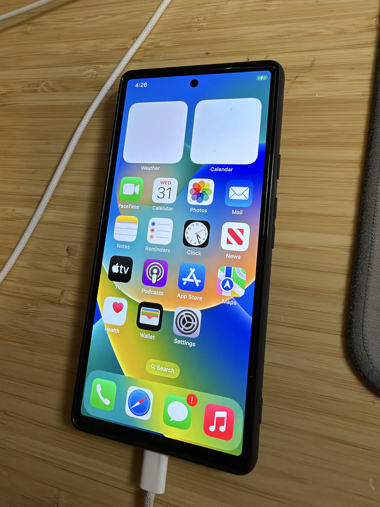
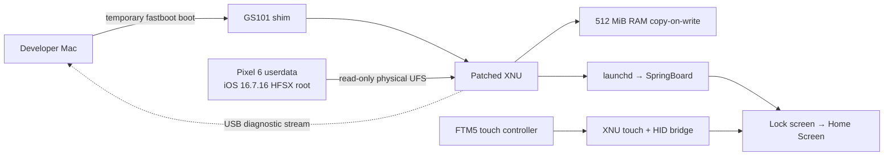

# iOS on Pixel 6

**An experimental iOS 16 port for the Google Pixel 6 (`oriole`).** On one physical device, the port has booted XNU, mounted an iOS root volume, reached the lock screen and Home Screen, and used the touchscreen to open Settings. This is the first research milestone, **not a public installer or a daily-use OS**.

[Project site](https://everettjf.github.io/pixel6ios/) · [Milestone 1 record](docs/MILESTONE-ONE.md) · [Milestone 1 release](https://github.com/everettjf/pixel6ios/releases/tag/v0.1.0-alpha.2) · [Installation status](docs/INSTALLATION-STATUS.md)



*Physical-device photo supplied by the project tester. The screen is a milestone observation, not evidence that every app or service works.*

## Milestone 1 · October 29, 2026

| Area | Verified result | Current limit |
| :--- | :--- | :--- |
| Boot | A temporary `fastboot boot` image starts the GS101 shim and patched XNU. | Normal power-on does not automatically start iOS. |
| System | XNU mounts the iOS 16.7.16 HFSX root volume; `launchd`, `backboardd`, and SpringBoard run. | The root image and some pinned build inputs cannot be redistributed here. |
| Display | Lock screen and Home Screen were observed on the physical Pixel 6. | The tested build draws debug text over the interface. A quieter candidate has only offline validation. |
| Input | FTM5 touch events reach XNU HID; a tester entered the Home Screen and opened Settings by touch. | Other gestures, multitouch, sleep/wake, and long-term touch reliability are not validated. |
| Network | USB logging and a local host/device link have been exercised. | Safari showed a blank page when opening Google; public Internet access is unverified. |

The result is specific to **one Pixel 6** and the recorded firmware/build configuration. The `v0.1.0-alpha.2` release captures this milestone; later documentation and host-side test improvements are on `main`. No claim is made for Pixel 6a or other devices.

## How it fits together



The userland baseline is iPhone X iOS 16.7.16 (20H392); the kernel is a port of open-source XNU 8796.141.3 with GS101-specific work. The Apple root image, firmware, raw device logs, and private build inputs are **not** committed. The experimental configuration reads physical UFS without writing it; runtime writes go to a volatile RAM copy-on-write layer. Preparing the `userdata` partition for this experiment erased its previous Android data. An ordinary reboot may lead to Android Recovery because Android cannot use that partition as its own data volume.

## Build and installation status

This repository is for source review and research. **Do not treat it as an install guide.** A fresh public clone cannot reproduce the tested image: the current local relink path uses pinned inputs under ignored `private/`, and the iOS root builder is not integrated as a public, verified workflow. There is no one-click installer, distributable iOS image, supported-device matrix, or independently tested recovery procedure.

For developers with the documented local inputs, the quality gate is:

```sh
research/pixelios-kernel/tools/check-all.sh
```

The local image builder, `tools/build-oriole-fbsnap-local.sh`, only creates an image; it does not contact a phone. Device work requires separate identity, firmware, image-hash, and recovery checks. See the [installation status and remaining gates](docs/INSTALLATION-STATUS.md) before attempting any hardware operation.

## What comes next

1. Reproduce the build from documented, redistributable sources and user-supplied iOS inputs.
2. Verify a clean-display build on hardware, then test gestures, multiple apps, and touch across long sessions and sleep/wake.
3. Establish device routing, DNS, and a successful Safari request; separately test other hardware services.
4. Document a repeatable Android recovery path and verify the result on a second Pixel 6.
5. Design and validate an opt-in persistent boot path with a dependable fallback.

## Repository map

- [`web/`](web/) — English GitHub Pages site; published from the `gh-pages` branch by a local deployment command.
- [`research/pixelios-kernel/`](research/pixelios-kernel/) — XNU, GS101 shim, device code, and patch stack.
- [`tools/`](tools/) — local build, preflight, diagnostics, and tests.
- [`docs/MILESTONE-ONE.md`](docs/MILESTONE-ONE.md) — English summary of physical-device evidence and its limits.
- [`docs/INSTALLATION-STATUS.md`](docs/INSTALLATION-STATUS.md) — English checklist of gates before public installation.
- [`docs/PIXEL6-TOUCH-BRINGUP.md`](docs/PIXEL6-TOUCH-BRINGUP.md) — chronological touch and boot research log (Chinese).
- [`docs/PIXEL6-USB-INTERNET.md`](docs/PIXEL6-USB-INTERNET.md) — USB networking research log (Chinese).

GitHub build CI was removed in favor of local validation. The site is static and has no tracking scripts. Its physical-device photographs were supplied by the project tester; the earlier low-resolution framebuffer samples remain research evidence, not marketing screenshots. The original port's history is retained in the `source-history` branch.
