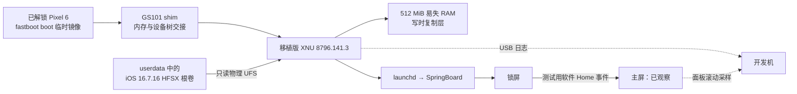
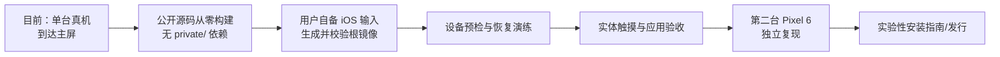

# iOS on Pixel 6

在 Google Pixel 6（`oriole`）上研究性地启动 iOS 16。项目已在真机到达 **iOS 主屏**，目前仍是需要开发者参与的移植实验，尚无面向普通用户的安装包。

> **2026-10-25 PDT 真机结果** · 临时启动的 XNU 挂载 iOS 16.7.16 根卷，运行 launchd 和 SpringBoard，显示锁屏；定时注入一个**软件 Home/Menu 事件**后，两次物理面板采样均显示主屏图标、分页点和 Dock。[查看证据与镜像哈希](docs/PIXEL6-IOS-HOMESCREEN.md)。另一次无软件 Home 事件的实测确认锁屏可重复到达，但实体上滑无反应：当前 Oriole 镜像明确移除了触摸硬件节点，尚不能用它判断触摸驱动是否可用。

> **2026-10-27 PDT 触摸硬件里程碑** · 一次独立的临时启动探测从 Pixel 6 触摸芯片读到 ID `0x36 0x48`，单次 SPI 命令、清理成功、两条供电轨恢复原值。[查看真机记录](research/pixelios-kernel/device/google/oriole/hardware/touch-id-success-2026-10-27.txt)。这验证了预内核通信通路；iOS 内的实体触摸仍需开发。

> **2026-10-27 PDT 事件读取进展** · 第二个独立探测镜像读取到一条 FTM5 就绪事件 `03 00 00 00 00 00 00 00`，随后恢复 SPI 与触摸供电并回到 Android。[查看 FIFO 真机记录](docs/ORIOLE-TOUCH-FIFO-PROBE.md)。这还不是手指触摸事件；iOS 上滑、点击与打开应用仍待 XNU 侧驱动接入和实体操作验收。

> **2026-10-27 PDT 实体触摸进展** · 同步真机诊断中，XNU 从 FTM5 收到手指按下、移动、抬起坐标，并在 HID 路径报告触摸；60 秒后两条供电轨恢复原值。[查看带构建哈希的采样记录](research/pixelios-kernel/device/google/oriole/hardware/xnu-touch-irq-sample-2026-10-27.txt)。这轮使用 Android 格式的 `userdata`，没有进入 iOS 界面；锁屏上滑和 App 点击仍未验证。

## 现在做到了什么

| 能力 | Pixel 6 当前状态 | 证据边界 |
|---|---|---|
| XNU、iOS 根卷、launchd | ✅ 真机验证 | USB 日志与屏幕观察 |
| 锁屏、主屏显示 | ✅ 真机验证 | 主屏由软件 Home 事件触发；面板采样为低分辨率滚动扫描 |
| 触摸芯片与 XNU 实体事件 | ✅ 真机验证 | 60 秒诊断收到真实按下、移动、抬起坐标；尚未用于完整 iOS 启动 |
| iOS 手势、打开应用 | ◻️ 尚未打通 | 现有主屏镜像没有触摸硬件节点；内核诊断不能代替界面验收 |
| Wi-Fi、GPU 加速、音频、相机、蜂窝网络 | ◻️ 待验证 | 上游 Pixel 6a 的成果不等于 Pixel 6 的结果 |
| 从公开仓库独立构建并安装 | ⛔ 尚未具备 | 当前本地构建依赖未公开的固定输入 |

先前完整 iOS 启动使用 `ufsrw=0`：XNU 不向物理 UFS 写入，根卷的运行时写入进入 RAM 写时复制层。**将 iOS 根镜像刷入 `userdata` 是更早的一次独立操作，已清空原 Android 数据**；之后的试验使用 `fastboot boot`，没有刷启动分区。此后为恢复 Android 做过 Factory data reset，已清除 `userdata` 中的 iOS 根镜像；截至 2026-10-27，手机可回到 Android 桌面。下一次完整 iOS 启动需要另行核对根镜像，并在刷写前取得新的确认。

## 两条路线

**研究者复现现有真机结果：**阅读[实验记录](docs/PIXEL6-IOS-HOMESCREEN.md)，从已验证的本地输入运行质量门禁与 `tools/build-oriole-fbsnap-local.sh --home-test`。脚本生成临时启动镜像，不会接触手机。公开克隆缺少专有输入，无法直接复现这一构建；目前也没有可分发的 iOS 根镜像。

**面向其他用户安装：**先完成[公开安装准备路线图](docs/PUBLIC-INSTALL-READINESS.md)。其中列出了可复现构建、用户自行提供的 iOS 输入、机型与固件核对、实体触摸、恢复路径和第二台设备验收的具体门槛。在这些门槛通过前，本仓库不提供一键刷机命令。

## 文档与源码

- [真机里程碑、构建哈希与注意事项](docs/PIXEL6-IOS-HOMESCREEN.md)
- [公开安装准备路线图](docs/PUBLIC-INSTALL-READINESS.md)
- [逐次启动和 UFS 诊断](docs/UFS-TIMEOUT-DIAG.md)
- [可行性调研（2026-10-24 历史快照）](docs/PIXEL6-IOS-FEASIBILITY.md)
- [开发交接记录](docs/ACTIVE-WORK.md) · [源码清单](docs/source-manifest.json)
- [移植源码、设备配置与 XNU 补丁](research/pixelios-kernel/)

选择的基线是 iPhone X 的 iOS 16.7.16（20H392）用户态和 PixeliOS 的 XNU 8796.141.3 / GS101 补丁栈。GitHub 构建 CI 已移除；本地质量门禁为 `research/pixelios-kernel/tools/check-all.sh`。原始设备日志、固件、Apple 镜像、私有构建输入和带屏幕内容的采样不提交到 Git。最初移植源码的提交历史保存在 `source-history` 分支。
