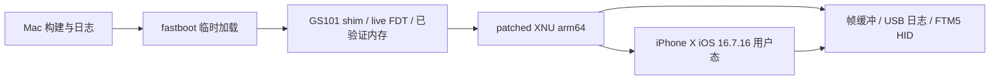

**Pixel 6 原生运行 iOS：可行性调研与开发方案（2026-10-24 历史快照）**

**2026-10-25 真机进展：**Pixel 6 已在临时启动中显示 iOS 锁屏，并在软件注入 Home/Menu 事件后到达主屏。本文下方的“尚未验证主屏”等判断是调研当时的状态。当前证据、镜像哈希、本地构建和未验证功能见 [PIXEL6-IOS-HOMESCREEN.md](PIXEL6-IOS-HOMESCREEN.md)。实体触摸和打开应用仍未验证。

调研日期：2026-10-24（洛杉矶）。对象为本次连接的 Pixel 6，而非假设中的 Pixel 6a。

**建议：立项做分阶段移植验证，首个产品目标限定为“原生启动 iOS 16、触摸操作主屏和少量系统应用”。选择 iPhone X 的 iOS 16.7.16（20H392）用户态，配合现有项目的 XNU 8796.141.3 补丁栈。当前证据支持尝试，尚不能承诺这台 Pixel 6 能启动到 GUI，更不能承诺日常使用。**

证据分四类：**本机实测**（ADB、fastboot 与裸机 USB 日志）、**上游报告**（维护者在 Pixel 6a 上的结果，本轮未独立复现）、**源码事实**（固定版本的代码/设备树）、**工程判断**（据此提出的开发路线）。四类不能互相替代。初始调研之后，已四次通过 `fastboot boot` 启动本地审查过的 oriole 只读探测镜像，收到 USB 日志并自动回到 Android。实验未执行分区刷写；加载器已在真机完成 XNU 段复制与启动参数构造，新实验已通过真机屏幕照片及 USB 日志确认 XNU 执行、自制 RAM 用户程序以 PID1 运行并完成系统调用，尚未验证 Apple launchd、SpringBoard 或完整 iOS 用户态。期间 Android 自行完成 OTA，当前版本与最初采集不同。开发过程与实测记录见 [ACTIVE-WORK.md](ACTIVE-WORK.md)。

**1. 已连接设备的实际条件**

| 项目 | 本机实测结果 | 对开发的意义 |
|---|---|---|
| 产品 / 平台 | Pixel 6，`oriole`，`gs101`，SKU `GB7N6` | 是所讨论的 Tensor G1 目标 |
| Android | 17，`CP3A.261005.002.A1/16269273`，安全补丁 2026-10-05 | 不应降级 Android/Bootloader 来追参考项目 |
| Bootloader | `slider-17.0-15681480` | 与参考 6a 的 `bluejay-16.3-13642543` 不同，需要重新验证交接行为 |
| 解锁状态 | `ro.boot.flash.locked=0`、`vbmeta.device_state=unlocked`、Verified Boot 为 `orange` | 已解锁；不需要为了本项目再执行一次解锁清数据 |
| 活动槽位 | `_b` | Android OTA 后切换；实验没有发出切槽命令 |
| CPU | 4 × A55（part d05）、2 × A76（d0b）、2 × X1（d44） | 与参考 Tensor G1 核心配置一致 |
| CPU features | 没有报告 `paca` / `pacg` | 不应以 arm64e iPhone 用户态作为第一阶段目标；还需裸机逐核 ID 寄存器确认 |
| 内存 | 裸机 live FDT：`0x80000000`、`0x880000000`、`0x900000000`、`0x980000000`，每段 `0x80000000`（2 GiB） | 低地址区有大量保留区域；后续 XNU 应从已验证的高地址区选择连续范围 |
| 屏幕 | `wm size` 返回 `1080x2400` | 与 6a 相同的物理像素尺寸；尚不证明 Bootloader framebuffer 的地址/步长 |
| 内核 | `6.1.157-android14-11-gbd23337e42e7-ab14791245` | 这是初始 CP2A 固件的记录；不是新版 CP3A 的内核证明 |
| 设备树目录 | 能看到 `memory@80000000`、`memory@880000000`、`memory@900000000`、`memory@980000000` 等节点名 | 高内存确实有额外节点，不能原样复制 6a 的 6 GB 表 |
| 读取权限 | Android 普通 shell 的 DT/块设备读取被拒绝；改用临时裸机探测 | 已测 live FDT、显示寄存器、高地址 UFS DMA 和 GPT；仍保留每次启动的运行时检查 |
| 存储路径 | `userdata -> /dev/block/sda27`，存在 `persist`、`efs`、`efs_backup` 等 | 只确认命名与链接，不代表已知分区大小或已完成备份 |

原始选定信息保存于本地忽略目录 `private/device-facts.json`，采集器为 `tools/inspect_pixel6.py`。采集器只接受单个已授权的 `oriole`，不会自动重启、提权或写设备；不会保存设备序列号。权限不足明确记录为未知，不把失败读取当成硬件值。

本机 fastboot 已实测 `product: oriole`、`unlocked: yes`。初始 CP2A 位于槽 a；后续 Android OTA 完成后，已重新采集当前 CP3A / 新 Bootloader / 槽 b。早期实验没有逐次记录固件与槽位，不能精确断定 OTA 发生在哪次启动之间。新增主机门禁严格核对 Bootloader、活动槽、该槽分区大小及获准实验类型；版本变化拒绝启动，不能自动继承旧版测量结论。

**2. 现有成果到底能提供多少帮助**

建议以 [PixOS-Project/pixelios-kernel](https://github.com/PixOS-Project/pixelios-kernel) 和独立的 [pixelios-userland](https://github.com/PixOS-Project/pixelios-userland) 为主线，以 [dristotle/ios-bluejay](https://github.com/dristotle/ios-bluejay) 的 SPI/触摸实现作为对照。不要直接混合两套补丁编号或套用第二套项目的镜像格式。

PixeliOS 的 [状态表](https://github.com/PixOS-Project/pixelios-site/blob/main/docs/STATUS.md) 报告：6a 已到主屏、八核和触摸可用；USB 网络可用于日志。Wi-Fi 仍在 PCIe/芯片识别阶段；GPU 能运行测试任务，但没有验证可用于 GUI 的渲染路径，部分 GPU 代码仍在实验分支。音频、相机、调制解调器尚未完成。这些是参考机的结果，不是本机结果。

除了 README，本轮还读取了蓝鸟的原始探测文本：它记录了 EL2 入口、逐核 feature、24.576 MHz timer、DECON 恢复，以及 UFS 初次超时；这比“只有一个成功声明”更有参考价值。但屏幕图像和完整 GUI 重现仍需我们自己取得。

GitHub API 显示两套项目近期都有成功 CI：PixeliOS 的 [39906729708](https://github.com/PixOS-Project/pixelios-kernel/actions/runs/39906729708) 对应 `759b3e3278b8…`；ios-bluejay 的 [39795615846](https://github.com/dristotle/ios-bluejay/actions/runs/39795615846) 对应 `a61bc40858d5…`。这只证明相应提交的工作流成功，不证明本轮下载的最新 HEAD、任何实验分支或 Pixel 6 已通过验证。

本轮固定的研究快照：

| 仓库 | 提交 |
|---|---|
| pixelios-kernel | `41198ee612c87314f66a2c067146729d290c6ba4` |
| pixelios-userland | `18a51b5333c09e4ac4c6f6dcd7f6eb91c2d2e040` |
| pixelios-site | `bd88f993b551a0bceb797ffbcd27ac86cda60302` |
| ios-bluejay | `770236a7ab8ea14101304e50b06d6fa54c49d52c` |
| PixeliOS 使用的 ios-sweet 上游 | `11da58bd050672960c0a83b5bef2176047eea479` |

快照和下载源码的 SHA-256 见 `docs/source-manifest.json`。后续开发必须另记实际编译提交、依赖、构建参数及镜像 SHA-256，不能用“最新版本”替代。

**3. Pixel 6 与 6a：真正重要的异同**

| 子系统 | 已查到的事实 | 方案与待验证点 |
|---|---|---|
| CPU、GIC、timer、PSCI | 同为 GS101；本机核型号与上游配置匹配 | 优先复用 SoC 代码，先 `cpus=1`，再 4、8；逐核验证 feature/中断，不先做 DVFS |
| 内存 | 本机 live FDT 已测四段各 2 GiB，参考机 6 GB | 从当前固件 DTB 和启动时 live FDT 取 banks、reserved-memory、memreserve；选经过验证的连续高内存子集，无须第一天用完 8 GB |
| 显示 | [Linux 主线 oriole DTS](https://github.com/torvalds/linux/blob/master/arch/arm64/boot/dts/exynos/google/gs101-oriole.dts) 给出 `0xfac00000`、1080×2400、stride 4320、`a8r8g8b8` | 本机 RDMA0 与 shadow 实测 Y8=0xfac00000、1080×2400、自然步长4320；后续真机照片已确认 XNU 文字控制台输出，尚无 iOS GUI |
| 面板 | Google oriole 树列出 `samsung,s6e3fc3`，以及备选 `s6e3hc2-fhd` | 第一阶段借用 Bootloader 已点亮的面板；不先写完整面板驱动、不追 90 Hz |
| 触摸 | Google oriole DTS 指定 ST FTM5，ID `36 48`，坐标 1079×2399；继承共用 FTS/SPI 配置 | 推翻“Pixel 6 大概率触摸芯片不同”的旧假设。优先复用 FTM5；确认本机固件、SPI/AP-AOC 所有权、reset、IRQ、rail，再读 ID/FIFO |
| 触摸接线/供电 | Google 共用树给出 SPI11、gpp23、gpp26、gpa9、LDO25M/LDO26M；oriole 固件名为 `ftm5_fw_o6.ftb` | 不拿 6a 固件刷触摸芯片；初期不更新触控固件，先使用其既有固件 |
| UFS | 同一 SoC 的驱动实现已经处理 Exynos 的 PRDT/slot/OCS 差异；本机 userdata 链接为 sda27 | 本机已实测 cold-init/HS-G4、高地址 DMA、LUN0 4096-byte blocks；GPT header/entries CRC 与 userdata 容量校验通过 |
| USB | GS101 DWC3 路径已有实现 | USB DMA pool 必须从当前 live FDT/控制器状态确认；不能只因存在 `abl@f8800000` 节点名就复制 16 MiB 长度 |
| Wi-Fi / GPU | 有上游早期进展 | 不列入第一次主屏演示的依赖；等本机基本启动稳定再逐项引入 |
| 电池、热、充电、休眠 | 上游不完整 | 初期短时、保守频率运行；先建立温度/供电记录，再谈长时间或性能测试 |

Google 触摸源码取自 [raviole 固定提交](https://android.googlesource.com/kernel/devices/google/raviole/+/81506b991a5385be6c59ee27df4dda2b1379c507/dts/gs101-oriole-touch.dtsi)，以及 `kernel/devices/google/gs101` 的 `android-gs-bluejay-6.1-android16` 分支中的共用触摸树。本地分别位于 `research/google-raviole/`、`research/google-gs101/`。这不是与当前 Android 17 build 完全匹配的设备树；只能用于交叉检查，不能省掉当前固件的离线提取和 live FDT 验证。

**4. 为什么选择这个 iOS 版本**

首选组合固定为：

- 用户态：**iPhone X / `iPhone10,3` / `D22AP`，iOS 16.7.16，build `20H392`**。
- 内核：PixeliOS 当前采用的 **XNU `8796.141.3`、plain arm64、16 KiB pages、SWEET machine config**，附带 GS101 补丁。它是经移植的开源 XNU，不是把 iPhone 原厂 kernelcache 原样启动。
- 文件系统：参考方案的 **16 GiB case-sensitive journaled HFS+（HFSX）镜像**，含 OS、SystemOS 和 AppOS 内容；实际允许大小须以本机 userdata 容量为准。
- 构建输入：Apple 官方 IPSW、对应的 `DeviceTree.d22ap.im4p` 和实际 dyld cache；下载后检查 BuildManifest 的产品/build、文件校验与 cache 架构。不能只凭文件名确认。

[Apple 确认 iOS 16.7.16 支持 iPhone X](https://support.apple.com/en-us/127113)。两个 Tensor 项目和 root-builder 又都明确依赖 `20H392` 的具体内容。选择它的核心理由是减少同时变化的变量，而不是声称它是当前最新的 16.x。

| 版本路线 | 判断 |
|---|---|
| iOS 16.7.16 / iPhone X | 首选。已有可参考的 plain-arm64 用户态、UI/HID/IOKit 适配、root 配方和设备身份 |
| 其他 iOS 16 补丁版本 | 暂不更换。文件名、缓存、系统服务及兼容补丁仍要逐项重新验证 |
| iPhone iOS 17 / 18 / 26 | 不作为第一条路线。其 iPhone 目标进入 arm64e/PAC 世代，本机未报告 PAC；除了驱动移植，还会引入指令与用户态兼容问题 |
| A10 iPad 的 iPadOS 17/18 | 可做后续独立研究。存在较老 ISA 的设备目标，但本轮没提取其 cache 验证，也没移植对应 XNU/IOKit/UI 契约 |
| 模拟器/虚拟机用户态 | 不作为本方案。目标是 Pixel 硬件上原生运行现有 ARM64 移植栈 |

PAC 不是“遇到就 NOP”能处理的：部分兼容 HINT 指令与带认证的分支/加载指令不同。后者可能需要模拟或重写；这会把项目扩大成另一类研究。Arm 的 [架构扩展说明](https://developer.arm.com/-/media/Arm%20Developer%20Community/PDF/Learn%20the%20Architecture/Understanding%20the%20Armv8.x%20extensions.pdf) 将 Pointer Authentication 列入 Armv8.3-A。项目还保留了上游 6a 逐核 `ISAR1` 的无 PAC 记录；本机暂只有 Android 公布的 feature 列表，不能把两种证据混称为同一次测量。

**5. 源码审阅发现：不是填一个 board.json 就结束**

下面是已经在固定快照中找到的具体适配点，而非泛泛的潜在问题：

| 文件/位置 | 现状 | 开发任务 |
|---|---|---|
| `upstream-patches/tools__mkpayload.py.patch:54` | CLI `--board` 只接受 `sweet` / `bluejay` | 改用经过校验的板表；增加 oriole 负例/正例验证 |
| `tools/build-xnu-image.sh:39–40` | 两处直接写 `--board bluejay` | 将目标贯穿 ADT、payload、shim、输出目录和 metadata |
| `tools/phone-state`、部分自动化 | 仍按 bluejay 判断设备 | 增加明确目标并拒绝错机；不能删除检查以绕过限制 |
| `tools/pix` scaffold | framebuffer 和 DRAM 为 0，占位表无完整 XNU/USB 信息 | 未采集前保持 non-bootable；补充拒绝零值、缺字段、跨保留区与溢出的校验 |
| `shim/shim.c:527–544` | 找不到 live framebuffer 时直接用板表，然后清屏 | 首次探测必须验证候选 framebuffer；不能用未确认的 fallback 地址写 RAM |
| `shim/shim.c:675` | 默认探测路径调用 `test_ufs_bluejay()` | 增加真正最小的 inventory 模式；把 UFS、SMP、触摸、GPU/WLAN 等分别显式开启 |
| `tools/backup-partitions.sh` | 即使用 `BOARD=oriole`，尾部仍对照 6a 的固定 userdata LBA | 改为读取并记录本机 GPT；不把 6a 边界当通用真值 |
| userland `tools/userdata-limits.json` | 只有 bluejay 容量 | 添加实测 oriole 容量；镜像校验必须使用本机上限 |
| `tools/mkadt.py` 的上游补丁 | 部分机型显示文本写死 bluejay | 人机显示名可改；D22AP/iPhone10,3 兼容身份应保留到用户态稳定后再评估 |

`tools/pix check` 是配置 sanity check，不是“这组物理地址在当前手机上安全”的证明。配置通过、内核编译通过、CI 成功，均不能替代设备验收。

**6. 实施路线与验收条件**



| 阶段 | 实际工作 | 必须留下的验收证据 | 未通过时的处理 |
|---|---|---|---|
| G0：设备与恢复资料 | 保留现有 Android，记录系统/slot/bootloader；确认本机匹配或更新且允许恢复的官方 factory image；明确备份可读性 | 身份匹配、恢复包来源/校验、备份清单，缺失项显式记录 | 不进入会覆盖 userdata 的步骤；不降级 bootloader |
| G1：主机构建与 oriole 适配 | 固定源码/依赖；完成上述 board 参数传递、错机保护、metadata 与最小探测模式；离线取当前固件 DTB/DTBO | 可重复构建；目标/配置/哈希对应；缺失字段、错误机型和未验证参数被拒绝 | 修复主机流程，无需反复试手机 |
| G2：最小临时探测 | 仅 inventory：live FDT、CPU/16K granule、timer、保留区、受控日志；屏幕与 USB 只在已验证范围内启用 | 完整 boot report；没有开启 UFS 数据写路径；手动可回 fastboot 并启动原 Android | 没有日志就先修观测通道；不靠盲改地址推进 |
| G3：XNU 无根启动 | `cpus=1`；ADT 去掉 UFS 节点，shim 不执行 cold-init；关闭 touch/GPU/WLAN/DVFS 和 userdata 持久日志 | 到达预期的 waiting-for-root；panic 可记录；反复启动可重现 | 区分 loader/MMU/IRQ/内存问题，不引入 iOS root |
| G4：只读存储验证 | 单独验证 UFS cold-init、LUN、block size、GPT CRC、userdata first/last LBA；从读取得到的事实生成板表 | 重复读一致；与可获得的固件/Android/fastboot 信息互证；未知边界拒绝操作 | 继续存储调试，不能为了“看主屏”提前放开写 |
| G5：离线制作用户态 | 取 iPhone X 20H392 的三份 DMG 与 ADT；按参考 recipe 合并；加入匹配的兼容改动 | BuildManifest、cache 为 arm64、权限/硬链接完整、fsck 干净、root checker 全通过、大小低于本机 userdata | 修复镜像构建，不拿手机做文件系统试错 |
| G6：首次 root 与 UI | 到这一步才准备具体 userdata 镜像及覆盖范围；确认清除 Android 数据后写入；先单核再多核 | HFS root、launchd、backboardd、SpringBoard；锁屏/主屏照片及完整日志 | 按日志区分磁盘/daemon/IOKit stall；保留可重现镜像 |
| G7：触摸与演示 | ACPM descriptor 与 rail 先读后验证；确认 AP/AOC 总线所有权，再读 FTM5 ID、ready/FIFO、HID；最后放开 4/8 核 | 本机 `36 48`、触摸事件、滑动解锁、进出 Settings、回主屏；至少三次冷启动重现 | 不凭“同型号”提高电压或刷触控固件 |
| G8：演示之后 | 按键、电池/热与持续稳定性、USB 调试，再决定 GPU/Wi-Fi 的投入 | 有明确定义的功能测试、温度/功耗观察和恢复记录 | 每个外设独立推进，避免一次引入多个实验驱动 |

顺序上 G4 与 G5 可在满足各自前提后分别进行；手机端每次只改变一个硬件实验变量。G3 的无根启动不需要覆盖 userdata。默认上游 XNU 图像构建器会启用 UFS cold-init，因此必须先完成入口适配，不能只在命令末尾加 `ufsrw=0` 就认为 UFS 完全没被访问。

“只读存储”不等于“不写寄存器”：点亮 framebuffer、停看门狗、设置 IRQ/USB 或 UFS 链路都可能需要易失硬件写入。每个阶段列出实际允许的写范围，代码以 opt-in gate 控制；不能拿 `fastboot boot` 本身的临时性替代这份约束。

**7. 第一批开发任务应是什么**

建议第一轮投入只交付以下四项，暂不把 rootfs 刷机作为任务完成条件：

1. **oriole 配置与证据表**：每个常量附来源、固件版本、`source_candidate` / `measured` 状态；未测的 `dram_banks`、`xnu_ram`、USB DMA 和 GPT 不得用 6a 值冒充。已读取初始 vendor_boot_a 与新版 vendor_boot_b；仍须以当前固件的 live FDT 校验运行时范围。
2. **构建链贯穿目标参数**：修正 mkpayload、build-xnu-image、phone-state/测试入口；用图像 metadata 绑定 board、commit、boot args、源配置哈希。构建输出不能让 bluejay/oriole 互相覆盖。
3. **最小 inventory 镜像**：先移除默认 full-probe 中不必要的 UFS/SMP/电源试验；地址未确认时支持不绘屏并通过可验证的日志路径报告。没有可信 DMA scratch 区时不启用 USB gadget DMA。
4. **一次受控的临时启动记录**：加载经过主机检查的 oriole 镜像，抓取 FDT/CPU/启动状态，返回 Android。之后才把探测结果转成可启动板表，并评估 G3。

上述工作完成后，最有价值的继续/停止判断是：“当前 Bootloader 是否接受我们准备的临时镜像，能否得到可信 live FDT 与日志，XNU 是否到达 waiting-for-root”。在这个判断前承诺 GUI 工期或成功百分比都缺乏依据。

**8. 开发环境与工作量边界**

以下首段是初次调研时的环境。后续已补齐交叉工具链、QEMU、官方 IPSW、参考 XNU 构建，以及隔离 Debian ARM64 VM；16 GiB 根镜像已构建并通过离线检查。

本机是 Apple Silicon Mac，装有 Xcode/Apple clang 21、`gh`，本轮已在项目内放置官方 Platform Tools 37.0.1。检查时未发现 Docker、qemu-system-aarch64 或 AArch64 GCC；磁盘可用约 110 GiB。没有为本轮下载完整 IPSW、安装 VM 或启动内核构建。

- Mac 负责 ADB/fastboot、源码、固件离线检查和日志。本轮 ADB 曾出现启动崩溃和一次暂时无法枚举设备；设置 `ADB_LIBUSB=1` 的采集器已完成读取，最后单次复查也能看到已授权设备，但尚未证明长时间稳定。稳定主机 USB 工具链也是 G1 的一部分。
- 内核优先使用上游验证过的 Xcode 15.0.1 构建环境。其工作流写明新 `iig` 的 IORPC ABI 不兼容；不能假设本机 clang/Xcode 21 原样编译就等价。可以复用可取得且核对过来源的参考构建，或部署相应 CI；是否还能稳定获得旧 runner/toolchain 要实际确认。
- shim 与 rootfs 优先放在隔离 Linux 环境。上游 rootless builder 仍依赖 Linux/FUSE、GNU 工具和 QEMU；“免 sudo”不等于现有脚本直接支持 macOS。
- 上游 Linux 本地内核构建器下载 x86_64 cctools；不能直接把它当成已验证的 Linux arm64/Mac 构建方案。若使用 arm64 VM，应另行验证工具链，或者只在 VM 制作 rootfs、内核走参考 CI。
- 建议预留至少 60–100 GiB 的工作空间（工程预算，不是实测最低值），并避免同时保留多份 IPSW、解包目录和 16 GiB root 镜像；当前 110 GiB 余量需要管理。

工作量按阶段决定：G1–G3 是一个可限定范围的启动适配试验；G4–G7 的投入取决于最新 Bootloader 下 UFS/USB/面板/触摸能否复用。Wi-Fi、Mali 图形加速和 modem 不应包含在“移植 Pixel 6 主屏演示”的工期里。上游的“agent-days”不是可用于本项目承诺的日历工期。

**9. 能得到什么，以及明确的退出条件**

第一阶段成功应定义为：本机原生执行补丁 XNU 与 iPhone X 用户态；能重复进入锁屏/主屏；实际触摸可用；能进入少量系统应用并返回；每次都能恢复到 Android 或 fastboot。它不意味着所有 Apple 系统服务、应用安装、账号、网络或硬件都工作。

现有方案使用平台服务替身和降低安全约束的兼容补丁。SEP、Face ID/指纹、Apple Pay、DRM/App Store 完整链路、OTA、相机、蜂窝及正常休眠均不能从“主屏出现”推出。初期按离线研究设备使用，不引入真实 Apple ID 或个人数据作为验收依赖。

出现以下情况应暂停对应阶段：没有可验证的恢复路径；临时镜像无法运行且解决方案要求写 bootloader/GPT/vbmeta；只能依赖无法确认的内存/DMA 地址；存储边界不明确；出现热/供电异常；写路径无法证明限制在目标 userdata。暂停的目的是缩小未知，不是通过降低 gate 获得一次偶然启动。

恢复应遵循 [Google 官方 factory image 说明](https://developers.google.com/android/images) 与实际版本的防回滚要求。本轮未完成与当前本机 CP3A build 匹配的下载项及 SHA-256 核验，故不能承诺“随时必然可恢复”。不要将重新锁 Bootloader 当作调试动作；只有完全恢复兼容的原厂系统后才评估是否重锁。

**10. 当前交付与下一步**

- 已完成：官方/项目资料核验、四个源码快照、Pixel 6 身份和解锁状态读取、CPU/显示基础信息、访问限制记录、源码级适配点和阶段验收设计。
- 新增真机结果：oriole 探测镜像已四次临时启动成功，USB 日志已采回；live FDT 的四个 2 GiB 内存段与 16 MiB ABL 保留区已经实测。静态 vendor_boot DTB 的 ABL 大小为 32 MiB，与 live FDT 不同，运行时校验不可省略。
- 新增离线结果：iPhone X iOS 16.7.16 用户态的 16 GiB HFSX 根镜像在隔离 Linux VM 中构建完成，fsck 和 12 项离线检查通过；不代表 XNU 已能挂载或启动 GUI。
- 新增存储实测（5332b32）：UFS high-DMA 0x880100000，userdata LBA0x22f1e6..0x1dc03fa，块长4096，容量0x1b91215000，与 fastboot 匹配；最终 doorbell/runstop 均0。没有媒体写入。
- 显示寄存器已测得 framebuffer 地址与几何参数；加载器日志证明清屏/绘制与 DECON 写入后能继续执行，实际屏幕可见内容尚未观察。
- 最小 RAM-only XNU 载荷已在 QEMU 启动 PID1，并完成三次等待系统调用；随后因 QEMU 没有板级 reset 实现而在重启路径 panic。该模拟器结果本身不证明真机执行；后续独立的原生 USB 枚举证据见下，PID1 与完整 iOS 仍未验证。
- 第一次真机 RAM-only XNU 尝试（a181884）：21项完整检查与独立复核通过，fastboot 接受临时镜像；未取得加载器 USB 故障日志，之后 Android 已重新上线，报告 watchdog,apc,early。该 bootreason 不能区分正常复位 fallback 与异常，也不能证明 XNU/PID1 已成功。
- 新增加载器实测（9181290）：11段复制、启动参数构造与跳转地址计算完成，主动返回后 USB 收到592字节日志，手机回到 Android；这不包含 XNU 执行。耗时与约一分钟 MMU-off 显示/复制、30秒USB窗口及Android启动一致，watchdog原因可能来自正常复位fallback。
- 新增复位实验（a2687bc）：USB 日志直接证明模式 SMC 返回 0、SYSIP 读回 0xfc；SWRESET 后手机仍进入 Android，未进入 fastboot。完整返回 Bootloader 路径未验证，不能拿这个结果作为 XNU 成功标记。
- 新版 CP3A 再验证：基础 inventory、96 项只读显示寄存器、11 段新载荷复制检查均取得完整 USB 报告并返回 Android。当前固件的 UFS 尚待重新验证。
- 新增原生 XNU 证据（0c4ea1c）：内核4724585f… / 载荷5139a045… / 启动镜像51b0eb32… 临时启动后，主机识别到仅由内核提供的 Sweet iOS USB Ethernet，配置1、CDC-ECM class2/subclass6，并绑定 AppleUserECM 与数据接口驱动。这证明 XNU 已执行到 network-ready 回调和 USB 初始化；不证明 PID1、图形界面或完整 iOS。手机已回到 CP3A/slotb Android。
- 日志通道阻点已由主机运行日志定位：configd 明确记录 Console locked, network interface[new] ignored。Mac 锁屏阻止新网卡注册；需用户自行解锁 Mac，再重试接收 UDP5140 上重复的 PID1 标记。没有修改主机安全策略。原生 USB 持续时间和 bootreason 均不能代替 PID1 证据。
- 下一步：用户解锁 Mac 后，复用精确原生 RAM+USB 载荷，配置新 USB 调试网卡并捕获 PID1 日志；随后重验 CP3A UFS、审核完整根文件系统启动配置，再接入完整用户态。匹配原厂恢复材料仍需补齐。**当前 RAM-only 验证不需要清 userdata，也不需要降级或重新解锁。**

本轮可重复的只读采集命令（在仓库根目录执行）：

```sh
python3 tools/inspect_pixel6.py
```

这份方案支持继续开发一个有明确边界的原生移植原型；它没有把 Pixel 6a 的成功转述成 Pixel 6 已成功。
