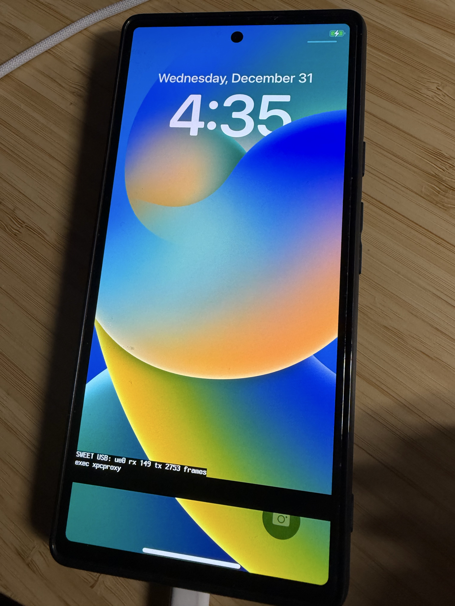
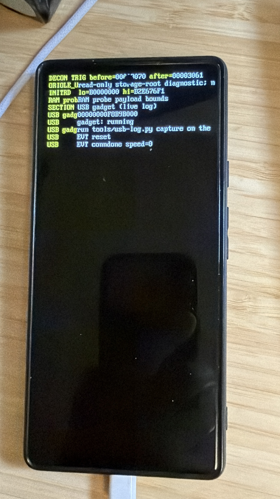

# Pixel 6 touch bring-up

Updated 2026-10-27 PDT. This is a staged hardware investigation, not an installation recipe.

## Known state

- **Observed on Pixel 6:** iOS 16.7.16 reaches the lock screen and, after a timed software Home event, the home screen. A physical upward swipe did not unlock; app taps have not worked. See [the home-screen record](PIXEL6-IOS-HOMESCREEN.md).
- **Read from this repository:** the Oriole iOS payload generator removes `/sweet-touch` and `/sweet-keys` from the Apple device tree. The existing GS101 FTM5 XNU driver only starts if `/sweet-touch` is present. The current iOS image therefore cannot deliver physical touches to SpringBoard.
- **Read from Google device-tree source; ID now observed on this Pixel 6:** Oriole lists an STMicro FTM5 controller on SPI11, with `36 48` as the expected ID. `device/google/oriole/board.json` holds the source-derived pins and coordinates. The ninth Oriole temporary boot below independently read those ID bytes; Bluejay results were not used as a substitute.
- **Observed on Pixel 6, 2026-10-26:** a complete read-only inventory boot (image SHA-256 `adaedfa98ce3b8e09390a00ae1a59214b198b5ea434a1a60869aa2efb603188c`) found USI11 mode `0` rather than SPI mode `2`; all four SPI pads, reset and mux were function `0`. No read faults occurred. See [the sanitized capture](../research/pixelios-kernel/device/google/oriole/hardware/touch-inventory-2026-10-26.txt). That initial probe deliberately did not read SPI engine registers in mode `0`; later runs established rail state, chip identity, and one boot-time FIFO response.
- **Observed on Pixel 6, 2026-10-26:** after an Android factory reset, the phone boots to Android initial setup. The earlier iOS HFSX root in `userdata` was erased by that reset. The read-only touch inventory ran from Fastboot and then returned to Android setup; an iOS interaction test will require a separately verified root-image reflash.
- **Observed on Pixel 6, 2026-10-27 (0118 synchronized run):** the 60-second XNU scan received real FTM5 `0x13` down, `0x23` move and `0x33` up records while the user touched the screen. Its HID path logged 277 down and 277 up reports, including coordinates and a second contact ID. No FIFO-read failure occurred; both touch rails were restored after the timer. The [0118 capture record](../research/pixelios-kernel/device/google/oriole/hardware/xnu-touch-irq-sample-2026-10-27.txt) distinguishes this run from an earlier no-touch baseline. This proves physical events at the kernel/HID driver, but the diagnostic boot still had Android-formatted `userdata`; it did not test a gesture or app tap in iOS.
- **Observed on Pixel 6, 2026-10-26:** authorized, non-root Android ADB reports a direct multitouch input device named `fts` under `spi11.0`, with X coordinates 0–1079 and Y coordinates 0–2399. See [the sanitized Android record](../research/pixelios-kernel/device/google/oriole/hardware/android-touch-2026-10-26.txt). Android denies reads of the SPI driver link and live device-tree property values; this observation confirms the Android input path, not the bare-metal chip ID or iOS touch.
- **Observed on Pixel 6, 2026-10-26:** the descriptor-only temporary boot returned `ACPM DESC rc=0`, channel 2, queue length 5, element size 16 bytes, with both request and response queues empty at 3/3. It automatically returned to authorized Android ADB. The [sanitized ACPM capture](../research/pixelios-kernel/device/google/oriole/hardware/acpm-desc-2026-10-26.txt) records the exact image hash and raw fields. That first capture made no IPC request; rail state was established only by the later rail-read capture below.
- **Observed on Pixel 6, 2026-10-26:** a separately reviewed, hash-pinned ACPM inventory made exactly two bounded PMIC `FUNC_READ` requests. S2MPG10 LDO25M (`0x5C`) returned `0x2C`; LDO26M (`0x5D`) returned `0x3C`. Both replies succeeded, and the phone automatically returned to Android ADB. The [sanitized rail capture](../research/pixelios-kernel/device/google/oriole/hardware/acpm-touch-rails-2026-10-26.txt) records the image hash and raw values. **Read from source:** bit 7 enables each rail, so both were disabled at this handoff. Voltage was not directly measured; the later ninth run obtained an SPI response.
- **Observed on Pixel 6, 2026-10-26:** the isolated `--inventory-acpm-rail-cycle` image read both exact off values, enabled LDO25M then LDO26M under mask `0x80`, read back `0xAC` and `0xBC`, then restored them in reverse order and read back `0x3C` and `0x2C`. Every IPC request returned zero. See the [sanitized rail-cycle capture](../research/pixelios-kernel/device/google/oriole/hardware/acpm-touch-rail-cycle-2026-10-26.txt). The image had no SPI, XNU, UFS or touch-pad code. The first host report was a parser false negative: ACPM `published=2` means the doorbell was rung, whereas the parser expected 1. The corrected parser accepts the full captured log and still rejects missing or failed steps. This test establishes the power cycle, not chip identity or touch events.
- **Read from this repository:** the GS101 XNU FTM5 driver's `tg_run()` in [patch 0088](../research/pixelios-kernel/xnu/patches/0088-sweet-gs101-touch.patch) configures clocks, pads, SPI and the controller, but has no ACPM or regulator call. The optional `/sweet-touch` ADT node alone therefore cannot power the two rails that were measured off at handoff. An iOS boot profile needs a separately reviewed rail-ownership path that leaves them on while touch is active and restores them on failure or shutdown. The inventory rail-cycle image deliberately restores both rails before reset and cannot serve as that path.
- **Observed on Pixel 6, 2026-10-27:** the ninth isolated touch-ID boot returned `0x36 0x48` from one SPI command. Preparation and cleanup both reported `OK`, and both touch rails read back at their original disabled values. See the [sanitized capture](../research/pixelios-kernel/device/google/oriole/hardware/touch-id-success-2026-10-27.txt) and [probe analysis](ORIOLE-TOUCH-ID-PROBE.md).
- **Observed on Pixel 6, 2026-10-27:** a later, separately pinned FIFO profile read `03 00 00 00 00 00 00 00` after the same verified ID exchange. The complete capture reports `OK` cleanup and both rails restored; the phone returned to Android. See [the FIFO capture](../research/pixelios-kernel/device/google/oriole/hardware/touch-fifo-ready-2026-10-27.txt) and [probe analysis](ORIOLE-TOUCH-FIFO-PROBE.md). This is one controller-ready event after reset, not a physical finger event or working iOS input.
- **Observed on Pixel 6, 2026-10-27 (0110 candidate):** temporary boot image SHA-256 `6edd2799fe0517f72deb32ed89698634c646273468900d68d3ea1799801e7db4` reached XNU and its USB network answered. A listener started after boot captured repeated `BSD root: ufsroot0` and `unknown Volume Signature : ea94` / `cannot mount root, errno = 19`. This is consistent with the known Android-formatted userdata after factory reset. The listener missed early touch setup, so this boot does **not** establish whether the XNU FTM5 controller identified successfully. The raw UDP capture stays in ignored `private/touch-xnu-source/relink/touch-0110-udp.log`.
- **Observed on Pixel 6, 2026-10-27 (0110 repeat):** a second `fastboot boot` of that same hash-pinned image, with UDP reception armed first, captured the XNU touch phase. `/sweet-touch` started, USI11 entered SPI mode 2, `USI_OPTION=1` and `SPI_FB_CLK=1` read back. The reset/ready poll saw no ready event in 1.5 seconds, and the chip-ID read returned `00 00 00 00` instead of `36 48`; the driver stopped at identify-only phase 1. This is a real XNU communication failure, not evidence of working touch. The log cannot distinguish rail loss after shim handoff, reset sequencing, bus ownership or SPI timing. The full private capture is `private/touch-xnu-source/relink/touch-0110-repeat-udp.log`; [selected non-identifying lines](../research/pixelios-kernel/device/google/oriole/hardware/xnu-touch-identify-failure-2026-10-27.txt) are tracked for review. `userdata` is still Android formatted, so this run cannot test iOS interaction.
- **Observed on Pixel 6, 2026-10-27 (0111 reset settle):** a temporary boot of commit `644a1fb` (image SHA-256 `1be8fc04e31de089a6b4f87f3c1dd2ade87c554ef24ae27ec4d0c1b015c1facd`) executed the additional 100 ms wait after reset release and read back reset GPIO as output/high. It still saw no controller-ready event and read ID `00 00`, then stopped before enabling scan. See the [sanitized capture](../research/pixelios-kernel/device/google/oriole/hardware/xnu-touch-reset-settle-failure-2026-10-27.txt). The touch-rail state at XNU identify time was not measured, so this does not isolate the failure to SPI or power.

## Safe first measurement

The Oriole inventory image accepts `--touch-probe` with **no options**. It runs the existing phase-1 `touch_probe_dump()` inside the already bounded inventory path, after live FDT and RAM checks. That function reads CMU, USI mode and GPIO pad registers; it reads SPI registers only when the USI mode is already SPI. The Oriole inventory guard rejects `--touch-probe=run`, `railsr`, `rails`, a payload, and other peripheral experiments. This change does not add a touch node to the iOS image.

```sh
cd research/pixelios-kernel
tools/check-all.sh                  # must print GATE PASS
shim/build.sh --board oriole --avb --usb-gadget --inventory --touch-probe
```

`check-all.sh` overwrites `shim/out/`, so build the probe again afterwards. Before a temporary `fastboot boot`, verify that exactly one attached device reports `product: oriole`, the bootloader is unlocked, and the image hash matches the freshly built probe. Capture the USB/RAM log and record the CMU, USI mode, seven pad values and any read faults. This phase does not read or write storage and does not modify partitions. The 2026-10-26 result above is from one such complete capture; it establishes the handoff state, not working touch.

After capture, run `python3 tools/report_touch_inventory.py private/<capture>.log --out private/touch-inventory.json` from the root checkout. The report keeps the raw touch lines and flags missing fields or read faults; `complete` means the log contains one whole read-only dump, **not** that the controller is identified or touch works. A truncated capture exits nonzero and must be repeated. Keep the raw log and report private until device identifiers have been reviewed.

The root-level `tools/boot_inventory.py --touch` helper requires the image's touch marker, a separate `inventory-touch` entry **and the exact SHA-256 image hash** in the private firmware baseline (`inventory_touch_image_sha256`). A generic `inventory` allowance or a linked marker alone cannot authorize the profile. The helper refuses firmware or slot drift and boots only the recorded serial. Add the mode and hash to a host's private baseline only after reviewing the exact built image; the helper checks phone identity again before temporary boot.

On macOS, `tools/run_touch_inventory.py --seconds 180` arms the CDC-ACM log receiver first, invokes that verified `--touch` boot helper, then runs the completeness report. It requires exactly the recorded serial in fastboot, no other connected inventory gadget, and `pyserial==3.5` in `private/gate-venv` (install locally with `uv pip install --python private/gate-venv/bin/python 'pyserial==3.5'`). It refuses to start when the phone remains in Android Recovery. Capture output stays under `private/touch-inventory/`; inspect the generated `capture.txt`, `usb.log` and `report.json` before drawing any hardware conclusion.

## Next gates

**Read from source, 2026-10-27:** the opt-in
`--xnu-ufsroot-cow-pool512-fbsnap-touchid` build now binds a hash-pinned
identify-only payload to a separate Oriole rail-handoff path. The shim checks
both measured off values, enables LDO25M then LDO26M using the existing
audited ACPM writer, and refuses XNU entry if the check fails. If the loader
returns, it attempts reverse-order restoration and records any failure.
The exact payload passes both the hash checker and the *runtime* UFS-root
bounds guard in a host test. The old no-touch profile remains separate.
**No XNU touch identification, physical finger event, gesture, or app tap has
yet been observed with this candidate.** [Patch 0110](../research/pixelios-kernel/xnu/patches/0110-oriole-touch-feedback-order.patch)
now applies the prekernel-observed USI option and feedback-clock order only
when an Oriole-specific `/sweet-touch` compatible is present. The Oriole
identify payload emits that compatible; other boards retain the old path.
The source was independently reviewed, the local relink produced a pinned
kernel, and `check-all.sh` passed at `821f766+dirty`. The second temporary
boot captured the early XNU touch phase and established that this candidate
does **not** identify the controller. Patch 0111 added the successful
prekernel probe's 100 ms reset-release wait and an output/high GPIO readback.
Its exact payload and boot image passed the local gate at `a615eb8+dirty`,
but the temporary boot again read `00 00`. Compare the remaining clock, pad,
rail and SPI transaction sequence with the successful isolated prekernel
probe. In particular, measure whether the two touch rails remain enabled at
the XNU identify point before attributing `00 00` to a software SPI difference.
**Read from source, 2026-10-27:** the isolated probe
issues the ID command before its first FIFO read, whereas patches through
0111 poll FIFO for a ready event before identifying. Patch 0112 changes only
the Oriole identify path to pulse and settle reset, then issue ID first.
The identify-only profile still cannot enable scanning. Its local quality
gate passed at `778970c+dirty`; the exact temporary-boot image SHA-256 is
`c6ce44d277ad39bb7bed92dacca6ac00eb1e2296681baebe9539eea27e325f3c`.
**Observed on Pixel 6, 2026-10-27 (0112):** one temporary boot of that exact
image reached the intended reset-settle then ID-before-FIFO path. XNU still
read `00 00 00 00` instead of `36 48` and stopped before scan. See the
[sanitized capture](../research/pixelios-kernel/device/google/oriole/hardware/xnu-touch-idfirst-failure-2026-10-27.txt).
This excludes FIFO-before-ID as the sole cause. It establishes no iOS touch,
gesture or app interaction.

**Observed on Pixel 6, 2026-10-27 (0113):**
[patch 0113](../research/pixelios-kernel/xnu/patches/0113-oriole-touch-id-mismatch-readback.patch)
adds a CMU, SPI and pad snapshot only after a completed but unmatched Oriole
chip-ID read. The first ID transaction therefore retains the 0112 ordering
and timing. A different model family independently reviewed the source and
the pinned local build profile. The kernel SHA-256 is
`075e96ae749269b0b067ca0cdf78f0f8146d0427813640adf6657438ddf0026a`;
the payload SHA-256 is
`006a69f04e03482b025e10ec41ec638d669d2f1bde4b5c03f7dcb1422183047d`.
The [sanitized hardware capture](../research/pixelios-kernel/device/google/oriole/hardware/xnu-touch-idreadback-failure-2026-10-27.txt)
records the exact boot-image hash and USB log. The ID remained `00 00`; the
post-ID CMU mux was `0`, the divider was `5` with BUSY clear, reset read high,
and the AP/AOC mux read low. This excludes a still-busy divider at that
snapshot as the direct explanation. The XNU-time PMIC rail state remains
unmeasured. No physical touch, gesture or app interaction was observed.

**Observed on Pixel 6, 2026-10-27 (0114):**
[patch 0114](../research/pixelios-kernel/xnu/patches/0114-oriole-touch-acpm-snapshot.patch)
adds a bounded, read-only snapshot of the ACPM channel-2 descriptor and four
queue indices after an Oriole chip-ID mismatch. It checks the mapped SRAM
window and requires the descriptor's queue-pointer offsets to match the
2026-10-26 measured values before reading those indices. It sends no ACPM
request, writes no PMIC register and does **not** reveal whether LDO25M or
LDO26M is enabled. A different model family reviewed the mapping and bounds.
The local kernel SHA-256 is
`69f0919a63fd098bbdd4188390608c3490c067dbbf66613095b49347030f20aa`,
the payload SHA-256 is
`dd31877a7892baf6d4ee20540da2e1ebc15a3916b78d8f08915fb004c2446857`.
The exact temporary boot image SHA-256 is
`c09395f5e70da3e9e9c7dd93dc9d09dc7b1b2d57d0925fe710e316c82d6911c8`.
The [sanitized hardware capture](../research/pixelios-kernel/device/google/oriole/hardware/xnu-touch-acpm-snapshot-2026-10-27.txt)
shows the ID still read `00 00 00 00`, while channel 2 was type 1 with five
16-byte entries and both request and response queues empty (`3/3`). This
confirms the descriptor and queue layout at the XNU identify point. It does
not measure the PMIC rails or prove that the APM responds to a new request.

**Read from source and the 0111 hardware capture, 2026-10-27:** the isolated
prekernel ID probe waits for the CMU mux and divider BUSY bit to clear after
each clock write (`shim/orioletouchid_hw.c:392-393`). The XNU experiment's
`sweettouchpoke` logs the immediate divider readback without that poll; its
0111 capture shows `0x10005`, including the transient BUSY bit. XNU then
spends at least 110 ms on the reset pulse and release settle before ID, so
this immediate readback **does not prove** the clock was still busy at the
transaction. Keep 0112 unchanged for its first hardware test. If it still
returns `00 00`, capture the CMU mux/divider state at the ID point and both
touch-rail readbacks before changing another clock or power writer.

**Observed on Pixel 6 Android, 2026-10-26 and repeated 2026-10-27:** read-only
`getevent -lp` showed an `fts` direct touchscreen with 10 slots and X/Y
ranges `0..1079` / `0..2399`. These match the current XNU driver's contact
count and raw coordinate range. See the [sanitized input inventory](../research/pixelios-kernel/device/google/oriole/hardware/android-touch-2026-10-26.txt).
This does not establish that XNU receives any touch event.

**Observed on Pixel 6, 2026-10-27 (0115):**
[patch 0115](../research/pixelios-kernel/xnu/patches/0115-oriole-touch-pmic-rail-read.patch)
adds one bounded ACPM channel-2 attempt after a failed Oriole ID read. It
checks the exact observed descriptor, empty queues and pointer offsets, then
requests the S2MPG10 LDO25M and LDO26M register values (`0x5c` and `0x5d`).
These are PMIC reads; the request publishes into shared SRAM and rings the
mailbox but does not issue a PMIC register write. A persistent atomic latch
prevents retries in the same boot, including after an uncertain timeout.
A different model family reviewed the revised patch. The pinned local kernel
SHA-256 is
`0e4e24b3ff98fa0f4ef6a813b98043de83c13564b1dba1ab408901daae6fb52e`;
the payload SHA-256 is
`6348489fad23c85f17c4123c5b3eca4069de1e2dd41564621ce58a49537b412a`.
The host build and payload guard passed. The first boot attempt used an
unwrapped 17 MB image and remained in Fastboot; the successful attempt used
the same payload in a 64 MB AVB-wrapped image, SHA-256
`a6e3013daf3fe848e3680dbbb474a2f2299b28b2cdc79fe0b3b1025dc3292caa`.
The [sanitized hardware capture](../research/pixelios-kernel/device/google/oriole/hardware/xnu-touch-rail-read-2026-10-27.txt)
shows two successful PMIC reads at the failed XNU ID point: LDO25M `0x2c`
and LDO26M `0x3c`, both with enable bit 7 clear. The XNU-time rails are
therefore off at that moment. The prekernel rail-hold source requires on
readbacks before handing off to XNU, but its earlier screen output was not
captured in this USB log; where the state changed remains unmeasured.
The next gate is a reviewed handoff that measures or enables them at the
XNU touch init point, verifies on readbacks, and restores them on any failed
ID or later touch initialization. Do not change the SPI transaction first.

**Observed on Pixel 6, 2026-10-27 (0116):**
[patch 0116](../research/pixelios-kernel/xnu/patches/0116-oriole-touch-rail-cycle-id.patch)
adds an Oriole-only `sweettouchrailcycle=1` identify experiment. It requires
mode 1, the measured ACPM channel-2 descriptor, empty queues, exact initial
LDO25M/LDO26M off values (`0x2c`/`0x3c`), and the ABL-style reset path. It
enables LDO25M then LDO26M, verifies `0xac`/`0xbc`, performs at most one chip
ID attempt, and tries to restore LDO26M then LDO25M with off readbacks. A
published ACPM request with a missing or invalid reply poisons the client and
stops further writes; in that case **one or both rails may remain enabled
until reboot**. The image uses a 180-second auto-restart for this reason.
The candidate XNU SHA-256 is
`d21a69b6481bcdd4cb2e23556b9407ff3eebd456cf7d85e91dced3b854f44774`,
payload SHA-256 is
`0ccaac530588a86864258d00c35cf7e6aaf8964a4d1ba2d8eaa481027bdfc4a2`,
and AVB-wrapped boot-image SHA-256 is
`d4ee1fc635d7bb7c36907be417cd1148ace59f465914b76bafb8c72e1844b5e7`.
An independent different-model-family review found no remaining concrete
hardware-write blocker. The local relink preserves the prior loaded segment
addresses and permits only an exact private-symbol delta. The temporary
`fastboot boot` produced [sanitized hardware evidence](../research/pixelios-kernel/device/google/oriole/hardware/xnu-touch-rail-cycle-id-2026-10-27.txt):
both rails read back on (`0xac`, `0xbc`), FTM5 returned `36 48 03 00` for the
chip ID, and both rails read back off after reverse-order restoration (`0x3c`,
`0x2c`). This proves XNU can communicate with the touch controller when its
rails are on. Scanning, physical events and iOS interaction remain untested.

**Observed on Pixel 6, 2026-10-27 (0117):**
[patch 0117](../research/pixelios-kernel/xnu/patches/0117-oriole-touch-rail-hold-scan.patch)
holds the verified rails for a bounded 60-second mode-2 scan, then restores
both rails. The temporary boot produced
[sanitized evidence](../research/pixelios-kernel/device/google/oriole/hardware/xnu-touch-rail-hold-scan-2026-10-27.txt):
chip ID `36 48 03 00`, controller-ready event `03`, scan mode entered, and
two FIFO status records (`43 05 ...` and `43 01 ...`). The 60-second timer
expired and the log confirmed reverse-order restoration to `0x3c`/`0x2c`.
No finger down/move/up event appeared. The timing of human screen touches
was not independently verified, so this does not yet distinguish an input
path fault from a missed test window. Gestures and app interaction remain
unverified. The image SHA-256 was
`d897fedbf6c1ef2478569f57846dcde1e48ae0c953a6dbf2f2901c5567083a2e`.

The Android factory reset also erased the iOS root in
`userdata`, so an iOS boot needs a freshly verified root image and a new
user confirmation immediately before any flash.

**Built locally, not yet run on hardware (0120 GUI trial, 2026-10-27):**
[patch 0120](../research/pixelios-kernel/xnu/patches/0120-oriole-touch-bounded-gui-window.patch)
adds an exact `sweettouchwindow=1200` boot argument for a best-effort 20-minute
powered touch window, timed from before the first rail-enable attempt. The
full-iOS profile keeps the 1800-second restart setting and does not inject a
software Home event. The kernel SHA-256 is
`b26952bb34e292b2cfea421ddf29efbb4d0509f042848dfdd2bc9db12d40327e`,
the payload SHA-256 is
`be6cd79bfd186f200b34bdef06d5c53c7b00e983348c86c2d354dd6d7c06acd8`,
and the selected 64 MiB temporary AVB boot image SHA-256 is
`b6b152dfba0228d1adf03339ad09493c5ccc96c2c0e10bcfceeb4d62c1dbfc11`.
The exact payload, runtime bounds guard, complete-image digest and AVB
footer/hash were checked locally; the repository gate printed
`GATE PASS fd5b540+dirty`. Independent different-model review found no
concrete blocker but emphasized that cleanup is best effort: a stalled thread,
uncertain ACPM state or earlier restart can prevent or preempt restoration.
The phone was in Android at the time of this update, and this image has **not**
demonstrated a physical iOS swipe, app launch or networking. The reviewed
source is on `main`; the device result remains pending.
Before another trial, `python3 tools/preflight_oriole_touch_gui.py --offline`
checks the two exact local images. With the phone attached in Fastboot, omit
`--offline` to additionally check that exactly the recorded unlocked `oriole`
is present, its bootloader and slot match the private baseline, and its boot
and userdata partition sizes are sufficient. This preflight uses only
`fastboot devices` and `getvar`; it never boots, flashes, or erases. A passing
preflight is not consent to flash `userdata` or evidence that the GUI works.

**Staged input-metadata candidate (0121, 2026-10-28; no Pixel 6 GUI result):**
The [0121 patch](../research/pixelios-kernel/xnu/patches/0121-sweet-hid-integrated-event-metadata.patch)
sets `IsBuiltIn` and `DigitizerIsDisplayIntegrated` on both the hand
collection and each finger event only when `/sweet-touch` has the exact
`pixelios,oriole-ftm5-spi` ADT compatible; the Bluejay event path remains
unchanged. The existing HID service publishes
`Built-In` and `DisplayIntegrated` as *service* properties, but its
`dispatchEvent` method only stamps the sender ID on each event. The
[reference input study](../research/pixelios-kernel/docs/research/22-hackios-reference-study.md#21-what-they-do)
found those two *event* fields in another iOS-on-Android touch bridge.
This is a source-backed candidate for events that reach HID but are ignored
by SpringBoard; it does not establish that this Pixel 6's GUI accepts them.
An independent different-model source review found no remaining issue after
the exact ADT gate was added; it did not compile or boot the change.
**Local build evidence, 2026-10-28:** the final stacked `SweetHID.cpp` compiled
with Xcode's ARM64 Mach-O C++ compiler and the repository's kernel include
configuration. The object SHA-256 is
`981d03e3937cd533a358c17b84b7850a3c3598dee24288b8fd8b7574d83ba639`;
its exported symbol names match the 0120 archive member. Replacing that one
member in the pinned 0120 archive and relinking succeeded. The resulting
offline kernel SHA-256 is
`89da99e097276dc4d5731ebb586e4716efed8936b8d8d33dd81e5a714350f109`
(16,697,320 bytes). Its entry point, load commands, loaded Mach-O segment
layouts, symbol names and `__LINKINFO` symbolsets match the 0120 kernel;
only `__LINKEDIT` size differs. The compiler command, logs, object, archive
and candidate kernel remain under ignored `private/touch-xnu-source/relink-0121/`.
This object check is **not** a complete XNU rebuild or device result. The Linux-only `xnu-local-build`
still cannot run directly on this Mac because its Linux host tools are absent.
**Local temporary-image build, 2026-10-28:** the 0121-specific payload checker
and runtime UFS-root bounds guard accepted the 16,713,664-byte payload SHA-256
`18c9801a52f33d39552302e16a5fd3db17664a06ae2735d44050e86a1268e5a2`.
The separate 0121 profile kept the same Oriole touch hardware flags as 0120,
while leaving 0120's 16,716,864-byte limit and checker unchanged. The shim
host tests and object audits passed. The selected 64 MiB AVB temporary image
SHA-256 is `a153da85ce9bbd3f519c83739e4d6cab1b1df7e220aa896f528c7c294bdb8d2d`;
the complete-image digest, embedded payload, Android v4 layout and local
image metadata were checked. The exact image and its metadata remain in
ignored `private/touch-xnu-source/relink-0121/`. A different-model review of
the profile and revised size guard found no actionable issue.
`python3 tools/preflight_oriole_touch_gui.py --offline --trial 0121` checks
the new image and the existing 16 GiB root-image hash locally. Trial `0120`
remains the default; selecting either trial leaves the other trial's SHA
unchanged. Omitting `--offline` adds the same read-only phone identity,
firmware, slot and partition-geometry checks as before.
Preserve the exact 0120 image as a baseline. A later 0121 trial must compare
the same physical lock-screen swipe and app tap, with the input window active,
and record both screen behavior and HID logs. If the 0120 baseline already
responds, the 0121 hypothesis is unnecessary.

**Observed on Pixel 6, 2026-10-28 (0121 first GUI trial; input result pending):**
After a fresh, explicit `userdata` confirmation, the read-only preflight
matched the pinned 16 GiB sparse root SHA-256 and 64 MiB 0121 boot SHA-256,
and verified exactly one unlocked `oriole`, its recorded firmware/slot and
partition geometry. `fastboot -S 128M flash userdata` completed all 94/94
chunks with exit status 0 in 363.380 seconds; no other partition was flashed.
The same read-only preflight passed again, and `fastboot boot` accepted the
exact 0121 image. The private USB capture is
`private/touch-xnu-source/relink-0121/gui-0121-udp.log`. Its early lines show
the FTM5 chip identifying, reporting sysinfo, and entering 1080x2400 scan;
the iOS userland reached `launchd` and then `SpringBoard`. The capture began
after the earliest root-mount messages, so it does not directly show that
transition. At the time
of this entry, USB logging and framebuffer swaps continued without a panic,
but no physical finger event had been captured and the current phone screen
had not been confirmed by the human. The later log printed
`rail hold: 1200-second scan window ended`, then readbacks for LDO26M and
LDO25M restoration; no physical down/up event was logged during that window.
The human subsequently photographed the iOS lock screen at 4:35 with the
bottom swipe bar visible, plus a frame showing the wallpaper and boot text
in landscape orientation. The lock-screen image also has a black strip of
console text across its lower part. These are physical screen observations,
not a clean display result. The human reported that an upward swipe had no
effect, then clarified it was attempted about 20 minutes after boot, when
the rail-hold window had ended. The capture contains no finger events in the
window. This does not establish a touch failure for 0121: there was no
confirmed finger test while the controller was powered. It proves neither
lock-screen input nor app launch. The 0120 baseline remains unrun for
comparison. The next run must synchronize the swipe with the first visible
lock screen, before the window ends; a later swipe is not a GUI input test.

**Observed on Pixel 6, 2026-10-28:** the human's original camera photo below
shows the 0121 lock screen on the physical panel. It is evidence of a visible
lock screen, not of a working gesture. The black console strip is present in
the original photograph; it was not added by the documentation. **Read from
source:** this profile inherits `serial=3` from the framebuffer base profile,
which enables on-screen serial output. A later clean-display profile should
use the separately gated `serial=0` path while retaining USB logging.



**Observed in the private 0121 USB capture:**
`tools/decode-fb-snap.py` reconstructed seven complete 60×134 rolling RGB332
frames. All seven decode to console text or boot graphics rather than an
unobstructed lock screen. Those low-resolution frames therefore cannot date
the first clean lock-screen appearance or replace the camera photograph. The
decoded PNGs remain in ignored `private/touch-xnu-source/relink-0121/`.

**Observed on Pixel 6, 2026-10-28 (0121 repeat):** after the same offline and
online read-only preflight passed, the identical AVB image was temporarily
started with `fastboot boot`; no partition was flashed. The USB capture in
ignored `private/touch-xnu-source/relink-0121/gui-0121-retry-udp.log` shows
FTM5 scanning and `SpringBoard`/`backboardd` execution. Two complete panel
samples before `rail hold: 1200-second scan window ended` still show an Apple
logo and progress bar, partly covered by console text. The human went to
sleep and made no synchronized gesture in this repeat. Consequently, this
run cannot establish whether 0121's HID event metadata reaches SpringBoard.
It does establish that the current 20-minute powered window can end before
the lock screen is testable. The next profile should first remove the
on-screen `serial=3` logging, keeping USB capture, then measure whether the
same bounded window spans the first visible lock screen. Do not claim a
physical gesture or app launch from either 0121 run.

The repeat's 30-minute private UDP capture is 538,298 bytes, SHA-256
`7e9be109b48549d2994eb1d19be39bfaf5d2694018c2207aaec65e81061f5365`.
It includes no physical touch/HID event or panic. The phone was unattended,
so absence of input events is expected; the capture is not a negative
gesture test. The two touch rails were read back at their original off
values (`0x3c` and `0x2c`) after the 1200-second limit.

**Built locally, not yet run on Pixel 6 (0122 clean-display candidate,
2026-10-28):** the [0122 payload checker](../research/pixelios-kernel/tools/oriole_touch_gui_0122.py)
uses the same pinned 0121 kernel, ADT, touch settings, 1200-second rail
window and 1800-second restart. The only payload byte changed is offset
`0x59`, ASCII `3` to `0` in `serial=3` → `serial=0`. The payload SHA-256 is
`91d586106277bb53eae6303441d9282f4a5be8a74e20a860f7535c363e572965`;
the 64 MiB local AVB image SHA-256 is
`cf4ef12866af697903d76a5eaae188cf80ee74bbe3a45997034f429a3e42701c`.
The 0122 build option reuses the 0121 runtime size guard and hardware compile
flags, but selects the new exact payload checker. An independent different-
model review found no actionable source or artifact blocker; it did not run
the phone. The output stays ignored under `private/touch-xnu-source/relink-0122/`.
The local offline preflight passes. A clean physical display, earlier lock
screen, gesture and app launch all remain **unverified** until a temporary
boot with synchronized human observation.

**Built locally, not yet run on Pixel 6 (0123 extended-window candidate,
2026-10-28):** [patch 0122](../research/pixelios-kernel/xnu/patches/0122-oriole-touch-extended-gui-window.patch)
adds an opt-in, exact `sweettouchwindow=2400` choice to the existing 60- and
1200-second choices. The separate 0123 profile uses `serial=0` and
`sweetrestart=3000`; it leaves the earlier profiles unchanged. The candidate
kernel SHA-256 is
`62c47dd99e2cfd9bf763c0b03c618223ca4deb4d1ab34c24e81a0abea1115d56`,
payload SHA-256 is
`6d114538e636421087bf86d634f851d564e9a6626d225cb0c987fff0ff75142d`,
and the 64 MiB AVB image SHA-256 is
`64a6aa547b5cac811b71ff8f80f7f0a9374fb18ad32ba8fe91cc4e87671abff7`.
An independent different-model source and artifact review found no blocker;
it verified that `SweetHID.cpo` and the other HID archive objects are
byte-identical to 0121. Local build, image checker, and offline preflight
pass. **No device boot or GUI gesture result exists for 0123.** The image
remains ignored under `private/touch-xnu-source/relink-0122/` and this patch
is still a candidate, not a verified hardware result.

1. **Extend the verified touch path to a full iOS boot:** the synchronized 0118 test established physical FIFO and HID events. The diagnostic's 60-second rail window is too short for the previously observed iOS startup. A separate, bounded GUI profile must keep the controller powered through startup, retain cleanup on failure/restart, and preserve a no-touch fallback. Have the hardware-writing change independently reviewed before a temporary boot.
2. **Verify GUI input:** after a freshly approved iOS root restore, test a physical lock-screen swipe, one app icon tap, and a return to Home. Capture both physical screen evidence and USB touch/HID logs; kernel coordinates alone do not establish that SpringBoard accepted a gesture.
3. **Observed iOS behavior:** restoring an iOS root to `userdata` requires a freshly verified image and new confirmation immediately before flashing. Then verify a physical swipe from lock screen to home screen, tap Settings, and return Home. A visible app launch and matching input logs are required before claiming interaction works.

Hardware-writing changes require the repository's independent review and stay on a local `wip/*` branch until it passes. The cycle capture helper, `tools/run_acpm_rail_cycle_inventory.py`, only accepts logs showing both exact on readbacks and both exact off readbacks after reverse restoration; a failed restoration remains an explicit failure. After the Android factory reset, the user separately confirmed a new `userdata` restore for the 0121 test; confirm the present partition contents before relying on them. Temporary inventory boots do not write `userdata`.

For a synchronized GUI retry, arm `python3 tools/watch_native_usb.py --seconds 2500 --cue-gui --out private/gui-capture-0124` before the verified temporary boot (choose a new, nonexistent output directory for each run). The watcher announces only after the touch scan and both `SpringBoard` and `backboardd` execution markers arrive, even when split across UDP datagrams; it suppresses a late cue if the rail window has already ended. This is only an early cue: it neither proves the lock screen is visible nor accepts a gesture. Observe the screen and swipe immediately when the real lock screen appears; record that time and the touch/HID events before the bounded rail window ends. The watcher does not boot the phone or change its network settings.

The same watcher now records `touch_events` and `hid_events`, plus `gui_touch_events` and `gui_hid_events` restricted to the interval after touch scanning and both GUI process exec markers and before the scan window closes. It announces the first coordinate event and first HID dispatch in that interval. These are log-line counts, not proof that SpringBoard accepted a gesture or opened an app. *Observed on hardware* in the older 0121 retry log: `SpringBoard` and `backboardd` exec markers appeared with scanning active, but no touch coordinate or HID dispatch lines occurred before the 1200-second window ended. The human's later swipe was outside that window, so this capture cannot determine whether the GUI bridge works when touched promptly. *Observed on hardware* in the separate 2026-10-27 IRQ probe: controller coordinates and HID dispatch lines were present before the scan window ended; that probe did not run the iOS GUI.

The watcher also writes `touch_timing` into `result.json`: host-observed seconds from scan start to both GUI exec markers, and from those markers to the first controller event, first HID down/up dispatch, and scan-window end. Missing markers are `null`. This makes a late swipe distinguishable from a timely swipe that reached the kernel but did not change the GUI; it does not establish that the lock screen was visible at the moment of the exec markers. A synchronized physical observation is still needed for that last step.

**HID service connection check (2026-10-28, source and unattended hardware observation):** The source in `xnu/patches/0058-sweet-hid-event-services.patch` logs `SweetHIDTouch open by IOHIDEventServiceUserClient -> 1` when the event-system client opens the touch service. An earlier physical boot capture, `private/photo-trial-20261025/udp.log`, contains that success immediately after `backboardd` starts. In a new 0126 temporary boot, USB capture was armed before `fastboot boot`; the 324,521-byte log contains touch scanning plus both GUI process start markers, yet no touch or button service-open line in the approximately twenty-minute observation. This is a **missing observation**, not proof that registration or event delivery failed: the USB log begins after early kernel initialization, and no person touched the phone in this run. It does make the service-open path a priority for the next synchronized gesture test. The private capture is `private/touch-hid-open-0126-20261028-night/udp.log` (SHA-256 `443c07a3cee97df7db019ec0ec89dc8f1e3add5ef7ce0d41e4a184414a4c092a`). `tools/watch_native_usb.py` now records `hid_touch_service_open` and `hid_buttons_service_open` as `true` for a captured successful open, `false` for a captured refusal, and `null` when no open result was captured. None of these fields alone proves that iOS reacted to a gesture.

**Observed on hardware, 0126 live lock-screen report, 2026-10-28:** The user saw the iOS lock screen and repeatedly swiped without a visible response. A later-started USB watcher captured 101 `0x33` leave events, 17 `0x27` events and one `0x17` event, but no HID touch dispatch. The old parser labeled `0x17/0x27` as ignored (`kind 5`, `raw 0,0`) and `0x33` as release (`kind 3`); subsequent IRQ samples were idle. The watcher started after the GUI markers and has no per-line timestamps, so the capture cannot assign each FIFO event to a particular swipe or rule out additional input failures. Its private log is `private/touch-gui-0126-live-20261028-0928/udp.log` (SHA-256 `3c6bde52eadf002e7990456e12c73020d86dbc3000ba29e66df956597bfdacd5`). **Read from source:** Google's downstream FTM5 interrupt handler dispatches point events on byte 0's high nibble, whereas our original `sweet_ftm5.h` required exact `0x13/0x23/0x33` bytes. Patch 0126 changes that parser to use the point-event class; the host test includes the captured `0x17/0x27` bytes. **Unverified on hardware:** the patched kernel has not yet shown an accepted lock-screen gesture or app launch.

**Built locally, 0127 temporary GUI trial, 2026-10-28:** `tools/relink-oriole-touch-xnu-0127.py` reconstructed patch 0126 from the original header, recompiled only the touch archive member, checked its public ABI and Mach-O geometry, and produced kernel SHA-256 `46cf3c1f38482b5e27cd36edf05acffc7dcad9a57907e75963ee0c5ef8db0711`. The exact 0126 boot arguments and ADT produced a 16,753,584-byte payload (SHA-256 `f6ae815b99f35d7e9095905b03f22bd9bfc94f262a2fcb719acf1620a904bfd5`). The 64 MiB AVB temporary image is SHA-256 `9034ca52784ccdc52b5d011636556d24873040d11144a1d69da0f611146c0d44`; its local image checker, `imgmeta` and offline device preflight passed. The image remains ignored under `private/oriole-net-route-source/relink-0127/`. **Unverified on hardware:** no physical swipe, HID event or SpringBoard response has yet been observed with 0127.

**Observed on hardware, unattended 0127 run, 2026-10-28:** A read-only preflight matched the sole connected unlocked `oriole`, then `fastboot boot` accepted the pinned 0127 image; no partition was flashed. The 40-minute USB capture (`private/touch-gui-0127-20261028-live/udp.log`, SHA-256 `ec0a4f4b4213357b9def264a00f8bff20f299e7bb730d262e217c46ad22eb982`) recorded touch scanning, SpringBoard and backboardd, and no panic. Twelve complete 60×134 rolling framebuffer samples showed the iOS lock screen through the end of capture, including the time and bottom home indicator; these private thumbnails classify the display state, not a sharp screenshot. The watcher counted zero point-event and zero HID-touch dispatch lines after startup. No synchronized physical swipe was confirmed during this run, so zero events are **not** evidence that patch 0126 failed or that iOS accepted/rejected a gesture. A fresh human gesture while the scan window is live is still required before claiming touch or app launch support.
The user later reported that swiping and tapping had no visible effect, but could not place those actions within the 40-minute scan window; that report therefore cannot be correlated with this capture.

**持续触摸的结构性缺口（2026-10-28，读自实际 0127 payload 与内核源码）：** 从上述固定 SHA-256 的 `oriole-touch-0127.payload.bin` 直接读出 `sweettouchrailhold=1`、`sweettouchwindow=2400`、`sweetrestart=3000`，且没有 `sweethidtest`。`sweet_touch_gs101.c` 的 `tg_run()` 从首次尝试给触摸电源轨上电起计时，达到 2400 秒后主动退出扫描、释放触点并调用 `tg_oriole_rail_stop()` 尝试恢复两条电源轨；3000 秒重启由另一条路径触发，两个计时起点不完全相同。因此即使一次窗口内上滑和 App 点按通过，这份镜像也不能满足“整次运行中手势持续可用”；存在触摸扫描结束而系统尚未重启的可能。下一版在谈自动进入 iOS 或日常使用前，需要有经过独立硬件审查的触摸电源所有权、异常/关机/休眠清理和恢复机制，并在真机验证超过当前窗口后的实体输入。不能简单删除计时器而不证明失败和退出时的电源轨状态。

**重启清理路径（2026-10-28，读自源码）：** `xnu/patches/0083-sweet-restart.patch` 与 `0100-sweet-remote-reset.patch` 中，`sweet_restart_poll()` 的定时重启和远程重启最终都直接调用 `sweet_machine_reset()`；该函数写 PMU 复位寄存器后等待复位，没有调用触摸驱动的清理函数。`PE_halt_restart` 的正常/ panic 重启入口也直接走同一函数。因此不能把扫描窗口简单延长到重启时刻，或删除窗口并假定重启前会执行 `tg_oriole_rail_stop()`。芯片级复位对这些电源轨的实际影响尚未测量；下一版须先设计并审查正常重启的清理握手，同时保留 panic/失联时的有界回退，再做真机验证。

For the next synchronized trial, `tools/watch_native_usb.py` includes host UTC receipt time and seconds since the GUI marker for the most recent 512 complete touch/HID lines in private `result.json`. These are receipt times, not timestamps generated by the touch controller. They let a reported swipe be compared with captured kernel and HID lines without treating an unobserved interval as a negative result.

**下一轮观察器补充（2026-10-28，本机代码与回放测试；未真机运行）：** 观察器还将有 `edges>0` 或 `events>0` 的 `SWEET TOUCH: IRQ sample` 行单独计为 IRQ 活动样本，记录 GUI 扫描窗口内的数量、首个样本相对 GUI 标记的主机接收时间，并单列 `errors>0` 样本。它不会把 IRQ 活动当成有效手指坐标，也不会把零 IRQ 样本当成“用户确实触摸但硬件失效”。下次应在锁屏出现后立即同步操作并记录时刻：若窗口内有 IRQ 而无 point 事件，优先查 FIFO/解析；若有 point 而无 HID，查驱动分发；两者都有而画面不变，再查 IOHID 服务与 SpringBoard 接收路径。窗口结束后的任何动作均不能用于这轮结论。
**离线回放观察：** 对上述 0126、0127 两份私有 USB 日志逐块回放，新计数器各识别到 1 条启动期 IRQ 活动样本，GUI 标记之后均为 0 条；两份日志的 GUI point/HID 计数仍均为 0。这与既有“无同步实体操作”边界一致，不是触摸失效的真机判定。

## 0128 同步触摸与 0129 HID 服务诊断（2026-10-28）

**真机观察：** 0128 的 64 MiB 临时启动镜像 SHA-256 为 `b4e0362437e929c562cd487da9fa1766e7ad1d8914dbe47f80f79eacb64f6006`。`fastboot boot` 后的私有 USB 日志 `private/touch-hid-0128-sync-20261028/udp.log` 记录了 87 条触摸控制器事件、11 条 GUI 阶段 IRQ 活动样本和 0 条 HID 触摸事件。第一条触摸发生在 GUI 标记后约 1492.476 秒，早于本轮 2400 秒的扫描窗口结束。前八条 C 桥接日志均为 `SWEET HID DIAG: bridge finger=0 down=1 service=0`。因此用户的操作**确实落在有效采样窗口内**，控制器坐标已到 XNU 桥接入口，但桥接当时没有可调用的 `SweetHIDTouch` 服务；不能再把无响应归因为操作太晚，也不能据此宣称 iOS 已接受手势。

**读源码：** 本仓库的 `SweetHIDTouch` 通过 IOKit `IOResources` personality 匹配后才运行 `start()` 并注册 HID 事件服务；`sweet_hid_touch()` 仅在该服务已发布时转发事件。上游 [ios-sweet 的移植笔记](https://github.com/dipa-studio/ios-sweet/blob/main/NOTES.md)把控制器、HID 桥接和 backboardd 列为连续链路；[PixOS Pixel 6a 项目](https://github.com/PixOS-Project/pixelios-kernel)报告的是另一机型的触摸结果，不能直接当作本机验证。[Apple XNU 的 IOService 接口](https://github.com/apple/darwin-xnu/blob/main/iokit/IOKit/IOService.h)描述了服务匹配、`start()` 和 `registerService()` 的生命周期。0128 证据把当前故障范围收窄到 HID 服务创建或启动，但尚不能区分 personality 未匹配与 `start()` 失败。

**本机构建：** [0128 补丁](../research/pixelios-kernel/xnu/patches/0128-oriole-hid-late-rematch-diagnostic.patch)为下一轮 0129 临时镜像增加 `SweetHIDTouch::start()` 阶段记录，并仅在 Oriole、显式 `sweethidrematch=1`、首次收到控制器事件且服务缺席时，请求一次异步 `IOResources` 重新匹配。服务指针以 release/acquire 原子方式发布；独立异模型复核了并发修正。0129 镜像 SHA-256 为 `e096c36f79d5cd9cb2cee2c061e4f81c198302dc85325c45d2ff46e36b35ce57`，由[固定哈希校验器](../research/pixelios-kernel/tools/oriole_touch_hid_rematch_0129.py)检查。

**真机观察，0129 初次尝试：** 离线镜像校验、目标设备身份/解锁状态/分区几何的只读预检均通过，`fastboot boot` 返回成功；没有刷写分区。USB 观察器只短暂看到设备枚举，未收到 XNU UDP 日志；用户随后报告手机回到 Android Recovery。当时还没有拍到早期屏幕错误，因此该轮不能作为 HID 重新匹配的真机结果。下面的 0130 屏幕证据与本机源码检查解释了这次预检遗漏。

## 0130 启动拒绝与 0131 配对镜像（2026-10-28）

**真机照片与重复观察：** 0130 诊断载荷沿用 0129 的 XNU/ADT，仅将启动参数 `serial=0` 改为 `serial=3`，试图把早期文字留在屏幕。旧 shim 搭配这个新载荷的 64 MiB 临时镜像 SHA-256 为 `60fd0052f23bad14ec8d8eb59b1f83a3be7b244e873d191aa130354075c51bb8`。两次只读预检均确认唯一、解锁的 `oriole`，`fastboot boot` 均返回成功，未刷写分区；USB 都只短暂枚举，没有 XNU UDP 日志，随后回到 Android Recovery。用户拍到的末屏显示 `INITRD` 后的 `RAM probe payload bounds`，再进入 `SECTION USB gadget (live log)`；`USB ... EVT conndone speed=0` 是后续 shim 诊断 USB 的事件，**不是** XNU 或触摸控制器报错。屏幕文字和源码共同确认 `loader_boot()` 在复制/跳转 XNU 之前返回了边界检查拒绝。原始照片来自用户拍摄的手机屏幕，不是 framebuffer 低分辨率采样。



**原因与检查缺口：** 0129 和 0130 的 boot 镜像复用了 0128 的 307,200 字节 shim（SHA-256 `0d180f7e5cfef697472b9425deb8bc04d9f043ee70451752190acc2c5d2b80ff`）。该 shim 编译时选中了 `ORIOLE_UFSROOT_COW_POOL512_FBSNAP_TOUCH_HID_DIAG_0128`，`ufsroot_payload_ok()` 将载荷内部布局限制在旧的 16,753,760 字节上限内。新载荷的 ADT 偏移从 `0xff6880` 变为 `0xff68f0`，末端达到 `0xffa4c8`，超出旧上限 `0xffa460`；入口地址和目标 kernel-end 值保持不变。外层 AVB、boot header、载荷自身 SHA-256 与手机身份检查都不能证明 shim 内编译的运行时 guard 接受该载荷。因此 0129/0130 **没有验证新 XNU 补丁，也没有触摸修复结果**。`tools/preflight_oriole_touch_gui.py --trial 0129` 现会在查询手机前拒绝该已知不匹配镜像。

**本机修复与验证：** 新的 0131 构建 profile 将固定 SHA-256 的 0130 屏幕诊断载荷（`6895c9476a9f5df9e988e91d836a3d9f0d8a032f1e410d190ca83599bdb0b3e1`）与专用 shim 编译选项成对构建；host 测试对同一 `ufsroot_payload_ok()` 运行时函数和实际载荷执行检查。新 shim 的 SHA-256 是 `3f69a7e8384ccb2237a4d538febba6e49947748a4f271f44a94ac9c886111360`；生成的 64 MiB AVB 临时镜像 SHA-256 是 `4c9c744f9ecb7cf0f1025f63365ca8557eeba49192816ba0f9502ef5f1524e2d`，已通过 payload、AVB、本机 guard 与仓库完整检查。它仍使用已有的 XNU HID 晚期重新匹配诊断代码，`serial=3` 会在屏幕叠加文字。

**0131 无人值守真机启动：** 仅对在线预检核实的唯一、解锁的 `oriole` 执行 `fastboot boot`，未刷写分区。Mac 检测到 `Sweet iOS _USB Ethernet_` (`1209:0001`) 并收到 XNU UDP 日志，确认 0131 已越过旧 shim 的载荷边界拒绝。日志出现 `SWEET TOUCH: scanning, 1080x2400 raw -> 1080x2400`、`exec SpringBoard` 与 `exec backboardd`。用户已入睡，本轮没有同步的实体触摸操作，因此没有手指坐标，尚不能触发 0128 补丁中“首次触摸且 HID 服务缺席”条件；当前日志也尚无 `SWEET HID DIAG` 服务启动/重新匹配记录。此轮证明启动配对修复有效，**不能证明手势或 App 点按可用**。原始 USB/UDP 日志保存在本机私有目录 `private/touch-hid-0131-sync-20261028/`，未提交到公开仓库。

**0131 观察器量化结果：** 只读接收 159,560 字节 XNU UDP 数据；触摸扫描开始后约 6.6 秒收齐两个 GUI 进程的启动标记。观察期间 `touch_events=0`、`hid_events=0`，`hid_touch_service_open=null`、`hid_buttons_service_open=null`，其中 `null` 表示**未捕获到打开结果**，不等于确认拒绝。旧的 `private/photo-trial-20261025/udp.log` 在 `backboardd` 启动后捕获过两个 HID 服务 `open -> 1`；当前日志没有同样的成功标记，故下一轮需要在锁屏出现后立即同步触摸，检查 `SWEET HID DIAG: late state`、异步重匹配请求、服务 `start()`/`open` 与实际 HID 事件的先后次序。不要用无人触摸的 0131 结果代替这条链路的验收。

**下轮采样工具：** `tools/watch_native_usb.py` 现在分别记录 `hid_late_state`、`hid_rematch_request_log_seen`、`hid_touch_start_log_seen`、`hid_touch_registration_log_seen`、`hid_touch_service_open` 和 `hid_bridge_without_service`。前三类 `*_log_seen=false` 只表示在当前 UDP 捕获范围内没看到相应文本，不能证明内核服务从未启动；`open=null` 同样只表示没捕获到客户端打开结果。观察器按完整换行处理跨 UDP 数据包的标记，避免把半条日志误判成成功。这样下一次实体手指事件发生时，可区分控制器事件到达、重匹配请求、服务创建与 iOS 客户端打开四个不同阶段。

## 0132 扫描启动时的 HID 服务诊断（2026-10-29）

**读源码与本机构建，尚未真机验证：** 0131 的首次手指事件才会请求一次 `IOResources` 异步重新匹配；无人值守启动没有触发该路径。[0129 补丁](../research/pixelios-kernel/xnu/patches/0129-oriole-hid-scan-probe.patch)把相同的一次性请求提前到触摸控制器开始扫描时，同时保留首次事件的后备触发。仅当 Oriole 设备树匹配、`sweethidrematch=1`、HID 服务指针为空且 `IOResources` 已存在时才请求；原子 compare-and-exchange 保证至多一次。它还记录扫描启动时的 HID 服务、按钮服务和启动阶段状态。异模型独立复核未发现阻断问题，但异步请求能否使服务启动，必须由设备日志验证。

**本机校验：** ARM64 触摸与 HID 对象已编译、重新链接；16,753,952 字节载荷 SHA-256 为 `9af5a83da5a12bad5c65d128fb8d78e5afcbd55fba7a05317354fcfcb4226804`。专用 shim profile 将其固定到运行时边界检查，64 MiB AVB 临时启动镜像 SHA-256 为 `d59ede3261ded33e81ba43e5146e4d04a917568a2c58069857001d6fa8e14838`。`tools/oriole_touch_hid_probe_0132.py` 与 `tools/preflight_oriole_touch_gui.py --trial 0132 --offline` 已通过。此镜像只用于临时 `fastboot boot`，不写启动分区；真机启动结果见下方，触摸响应和 App 打开仍未得到验证。

**观察器：** `tools/watch_native_usb.py` 把 0132 的 `scan` 与 `first-event` 状态分别保存为 `hid_scan_state`、`hid_first_event_state`，并单列实际发起异步请求的 `hid_rematch_cause`。日志中的“请求已发出”、HID `start()`、服务注册、客户端打开和可见手势仍是不同的验收阶段；只有后续真机日志及屏幕操作能证明最后一段。

**源码核对后的判读顺序：** 固定的 0132 内核二进制含 `SweetHIDTouch`/`SweetHIDButtons` 两个 `IOResources` personality 和对应的元类名称；XNU-8796 的 `IOCatalogue::init()` 会索引这些 personality，`isModuleLoaded()` 把无 bundle 标识的 personality 视为内建驱动，`IOService::registerService(kIOServiceAsynchronous)` 在需要配置且服务非 inactive 时安排匹配任务。这说明扫描时请求重新匹配是有源码依据的诊断动作，**仍不证明匹配成功**。若 `hid_scan_state.stage=0` 且请求已记录、之后没有 `start`，先查 catalog/匹配与日志覆盖范围；若阶段停在 1–2 且有 `start failed`，查锁或基础 HID 初始化；若阶段到 4 且服务已注册而无客户端 `open -> 1`，查 backboardd 的发现/打开路径。任何缺失的标记只表示本次 USB 捕获未见到，不能独立推断内核从未执行该阶段。

**旧镜像对照与采样边界：** 本机只读检查 `0121`（内核 SHA-256 `89da99e097276dc4d5731ebb586e4716efed8936b8d8d33dd81e5a714350f109`）与 `0128`（`679fb4af0ac803672d8d324b4fd5e928e52f659361e8edad2bdb01e1fdedcfd5`）的已链接 Mach-O 内核，二者都含一份 `SweetHIDTouch` 的 `IOResources` personality 字符串，以及 `SweetHIDTouch::start`、元类和静态桥接指针符号；因此不能把 0128 的服务指针为空直接归因于 personality 在链接时丢失。旧的 `private/photo-trial-20261025/udp.log` 捕获到 backboardd 成功打开触摸与按键服务，而 0131 的 USB 日志从 usermanagerd 的较晚启动阶段才开始，可能漏掉早期 `start()` 记录。0128 在实际手指事件到达时记录 `service=0`，这是比“日志里没看到注册”更直接的故障证据。下一步仍须用 0132 的扫描时状态与同一轮的服务打开、手势结果验证运行时因果链。

**0132 联机门禁的本机观察（2026-10-29）：** Mac 的 `ioreg` 枚举到 Google Pixel 6 `18d1:d001`，但 `adb devices -l` 与 `fastboot devices -l` 均为空。随后用本机 libusb 仅读取配置描述符（未打开或认领接口、未传输端点数据），测得唯一接口为 class/subclass/protocol `ff/42/01`，有两个端点。Android [ADB 源码](https://android.googlesource.com/platform/system/core.git/+/f03fdfcbdc406a2fd1dd7839166c00bba631dd0c%5E2..f03fdfcbdc406a2fd1dd7839166c00bba631dd0c/)把 `ff/42/01` 定义为 ADB，而其 [Fastboot USB 协议](https://android.googlesource.com/platform/bootable/libbootloader/+/refs/heads/main/gbl/docs/GBL_EFI_FASTBOOT_USB_PROTOCOL.md)要求 `ff/42/03`。因此这次 USB 连接**不是可操作的 Fastboot 接口**；`d001` 产品号和设备名称本身不足以证明手机停在 Fastboot。`01` 协议也不能证明 ADB 守护进程在线或屏幕所处状态。在线预检拒绝 0132 启动是正确结果；只有重新观察到唯一、身份匹配的 Fastboot 设备，才可进行临时 `fastboot boot`。本段没有改变手机存储或启动分区。

**0132 真机观察（2026-10-29，无人触摸采样）：** 手机重新进入可用 Fastboot 后，联机只读预检核实唯一、已解锁的 `oriole`、固件与镜像哈希，`fastboot boot` 成功临时加载上面的 0132 镜像；未刷写分区。Mac 收到 185,509 字节 XNU USB/UDP 日志，看到 `SWEET TOUCH: scanning`、`exec SpringBoard` 与 `exec backboardd`；日志开始于扫描前。扫描时的明确状态是 `stage=0 buttons=0 touch=0 resources=1 rematch=1`，随后出现 `asynchronous IOResources rematch requested by scan`。本次捕获余下约 9 分钟内未见 HID 服务 `start()`、注册或客户端 `open` 日志；这说明请求已发出，但**没有观察到**服务完成创建，不能把请求等同于修复。无人实际触摸，`touch_events=0`、`hid_events=0` 不构成手势失败测试。原始记录仅保存在本机忽略目录 `private/touch-hid-0132-live-20261029/`，`udp.log` SHA-256 为 `cea35ff700c700042278c34256ffaf3d04deeff9dae6a0703a3e096f22cf5527`；`result.json` 保存观察器计数。下一步应在保持只读临时启动的前提下，查明 `IOResources` personality 是否进入 catalog、匹配任务是否运行，以及为何触摸服务 `start()` 未被观察到，再安排有人在锁屏出现时同步测试。当前没有证据证明触摸、App 打开或自动进入 iOS 可用。

## 0133 HID catalog 诊断候选与后续真机结果（2026-10-29）

**读源码：** 0132 在扫描时确认 `IOResources` 存在且发出异步重匹配请求，但未观察到 HID `start()`。XNU-8796 的 `IOCatalogue::findDrivers(IOService *, SInt32 *)` 从服务元类及其父类索引 personality；`OSMetaClass::getMetaClassWithName` 可核对内建类在运行时是否注册。[0130 候选补丁](../research/pixelios-kernel/xnu/patches/0130-oriole-hid-catalog-probe.patch)只在 Oriole 的扫描启动路径记录这两项状态，不读写触摸寄存器，也不改变匹配结果。候选数量仅表示 provider 类索引命中，**不等于**属性匹配、服务启动或手势有效。

**本机构建：** 0133 内核 SHA-256 为 `50930206a85b9225d912fff5461b8598dce5b52b50788e41359ab3d3c92ea1d1`，载荷为 `5f928583f19f82db9a4544ab238fa76cd94a1dca63053291cd78a8340503ecc7`，64 MiB AVB 临时启动镜像为 `0c2410cea909a04bbbe41340062b5616004f454d0b945b9af906863bec532587`。内核编译、重链接、载荷边界测试、整镜像哈希核对、离线预检与完整仓库检查通过（`GATE PASS fcd6b51+dirty`）；异模型只读独立复核未发现阻断问题。候选文件保存在本机忽略目录 `private/touch-hid-0133-work/`。该次离线检查时 Mac 未识别到 Fastboot 或 ADB，因此当时**尚未执行 `fastboot boot`**；随后恢复连接后的真机结果见下方。0133 不能证明 iOS 手势、系统 App 或网络可用。

## 0133 真机 panic 与 0134 ABI 修正候选（2026-10-29）

**真机观察（0133）：** 唯一已解锁 `oriole` 的只读预检通过，`fastboot boot` 临时启动了 SHA-256 `0c2410cea909a04bbbe41340062b5616004f454d0b945b9af906863bec532587` 的镜像，没有刷写分区。用户拍摄的末屏显示 FTM5 触摸控制器完成识别、开始扫描，随即出现 `OSMetaClassBase::_RESERVEDOSMetaClassBase5 called. @OSMetaClass.cpp:164` panic；Mac 的 USB 日志只收到约 5.5 KiB。该轮没有到达锁屏，也没有证据显示 HID 服务已创建。原始照片由用户在聊天中提供；原始 USB 捕获保存在本机忽略目录 `private/touch-hid-0133-live-20261029/`。

**从源码与二进制读取（故障定位）：** 0133 的 `SweetHID` 对象在调用 `OSOrderedSet::getCount()` 时使用 vtable 偏移 `+0x90`；已链接内核在该偏移的目标正是 `_RESERVEDOSMetaClassBase5`，与照片里的 PC `0xfffffe0007969198` 对应。旧的单文件重编译命令遗漏了 `-DXNU_TARGET_OS_OSX=1`，而基线 XNU 使用该宏生成带 KEXT vtable padding 的 C++ ABI。因此 0133 的 catalog 诊断代码与基线内核的虚函数表布局不兼容。此结论解释这次 panic；它**不证明**此前所有 HID 服务缺席都由同一问题造成。

**本机构建（0134）：** 保持 0130 触摸源码及启动参数不变，使用带 `-DXNU_TARGET_OS_OSX=1` 的命令重编译 `SweetHID.cpo`，再以原 XNU 链接参数、原 `__LINKINFO,__symbolsets` 和固定 UUID 重新链接。新内核 SHA-256 为 `f49ac09d591b577872ff009c9ee77c5e287ee4bb6873099ff82ffffa3d291c4e`；载荷 SHA-256 为 `8b97c924fe5218bfe9503890600c049313b8aba6879604633a5f08f3613feff3`，大小 16,757,152 字节。Mach-O 入口、段集合及符号集与 0133 一致。新对象的 `getCount()` 调用使用 vtable 偏移 `+0x150`；在已链接内核的 `OSOrderedSet` vtable 中，该槽位指向 `OSOrderedSet::getCount()`，而 0133 的 `+0x90` 槽位指向触发 panic 的保留函数。专用 shim profile 限定载荷布局；64 MiB AVB 临时启动镜像 SHA-256 为 `96552f757514f6de18d9cc80ee609f2fbf1eda98614e624473ebd2b80c711389`，哈希校验器拒绝其他内核、ADT、启动参数及镜像。本机整镜像校验与离线只读预检通过。所有二进制和编译记录均在本机忽略目录 `private/touch-hid-0134-work/`，不提交 Apple 二进制或设备日志。实体手势与 App 打开的真机验收仍未完成；下一段记录首次临时启动结果。

**补丁重放与复现门禁（2026-10-29，本机验证）：** 旧 `0130` 补丁的零上下文插入点在普通 `git apply` 下可能落到文件末尾，不能可靠重建实际编译的源码。现已用有锚点的标准补丁重写；[离线重链接脚本](../tools/relink-oriole-hid-abi-xnu-0134.py)从 0129 之后的源码重放补丁并逐字节比对已审核源码，明确加入 `XNU_TARGET_OS_OSX=1`，重新编译归档成员、链接并核对 `OSOrderedSet::getCount()` 槽位及最终内核哈希。输出 `OFFLINE HID ABI RELINK PASS f49ac09d…`，不接触手机，也不把真机触摸标记为通过。归档容器记录成员时间戳，因此脚本验证成员内容与最终内核哈希，不依赖归档容器哈希。

**真机观察（0134，2026-10-29 PDT）：** 联机只读预检核对了唯一、已解锁的 `oriole`、固件、槽位、分区几何和上述镜像哈希。仅执行 `fastboot boot` 临时启动，未刷写分区。Mac 的 20 分钟只读 USB/UDP 观察收到 330,642 字节日志，记录 `SWEET TOUCH: scanning`、`exec SpringBoard`、`exec backboardd`，以及 `SWEET HID DIAG: catalog generation=1 candidates=6 touch=1 buttons=1 meta-touch=1 meta-buttons=1`。扫描时 HID 状态为 `stage=4 buttons=1 touch=1 resources=1 rematch=1`，随后 iOS 客户端分别成功打开 `SweetHIDTouch` 与 `SweetHIDButtons`（两条 `open by IOHIDEventServiceUserClient -> 1`）。观察范围内未见 0133 的保留虚函数 panic；这证明 ABI 修正越过了该故障点，且本轮触摸 HID 服务被客户端打开。

**验收边界：** 同一观察器记录 `touch_events=0`、`hid_events=0`、`gui_touch_events=0`，未收到与本轮同步的实体上滑结果。启动时的两条控制器 `kind 5` 事件不是手指坐标。因而本轮不能证明手势、解锁或 App 点击可用，也不能用“零触摸事件”断言它们失败。下一轮须在图形锁屏出现后、扫描窗口内同步上滑，比较控制器事件、C 桥、HID 分发与屏幕变化。原始日志和 `result.json` 仅在本机忽略目录 `private/touch-hid-0134-live-20261029/`；`udp.log` SHA-256 为 `73ddab23cca67b90c0b65622c171819a0bd64e285dff087cd45c6229f6b42103`。没有照片或面板采样可独立确认本轮屏幕确实显示锁屏。

## 0134 实体交互里程碑（2026-10-29）

**真机观察：** 保持同一 SHA-256 `96552f757514f6de18d9cc80ee609f2fbf1eda98614e624473ebd2b80c711389` 的 0134 临时启动镜像运行。用户先报告 iOS 锁屏和触摸“有反应”，随后明确确认通过实体触摸进入 iOS 桌面，并打开“设置”；操作速度较慢。后续只读 USB/UDP 捕获出现真实控制器事件及 `SWEET HID: touch 0 down/up`，包括坐标 `(727,528)`、`(955,2132)`。原始捕获保存在本机忽略目录 `private/touch-hid-0134-followup-20261029/`，`udp.log` SHA-256 为 `70a259065706a1c654abc985d8aa180b2a092e439b53c9ddcc9660faeef1d3fa`。这轮观察器从启动中途开始，未捕获完整 GUI 启动标记，因而计数器中的 `gui_touch_events=0` 不能用于否定用户的实体交互结果。此前同一镜像的完整捕获已确认触摸 HID 服务成功启动并被 iOS 客户端打开。

**仍待解决：** 用户在 Safari 打开 Google 后看到空白内容区，没有明确错误提示；本机 USB 链路通畅不等于 iOS 可访问互联网，尚未证实设备侧默认路由、DNS 和公网请求。0134 的 `serial=3` 启动参数使调试文本持续叠在屏幕上，影响显示。`serial=0` 的静默变体尚未真机验证，本阶段版本仍以 0134 为基线。iOS 自动启动、其他 App 与长期稳定性也未验收。以上均为单台真机观察，当前版本不是可供普通用户安装的发行版。

## 0135 静默显示候选（2026-10-29，离线验证）

**从本机产物读取：** 0135 复用 0134 已真机运行的 XNU 内核和触摸设备树，仅将载荷启动参数 `serial=3` 改为 `serial=0`。逐字节比较两个 16,757,152 字节载荷，只有偏移 `0x59` 的一个字节不同；0135 载荷 SHA-256 为 `53b28fdd2c0c5494fd1628ecea90ec51b00d9bf79340e21f122cd687fe3dc423`。新的 shim 构建选项复用 0134 的运行时 UFS 根卷边界守卫，并通过专用载荷校验器固定内核、设备树与启动参数。64 MiB AVB 临时启动镜像 SHA-256 为 `f2f18d92f74ff6f2550b3983295c1584f8c316ebb36fcbc29b3959c77a6716cc`；整镜像检查和 `tools/preflight_oriole_touch_gui.py --trial 0135 --offline` 均通过。产物保存在忽略的 `private/touch-hid-0135-work/`，不提交二进制。

**验收边界：** 0135 尚未在手机上启动。此前[另一轮独立的 `serial=0` 真机试验](UFS-TIMEOUT-DIAG.md)已经显示过没有文字覆盖的 iOS 锁屏，并保留了 USB 日志；但该轮不含现有实体触摸/HID 配置。0135 的实际显示、触摸、App 行为与 USB 日志能否同时保持，仍须用下一次核实身份后的只读 `fastboot boot` 真机测试验证；当前不将 0135 作为已通过的发行配置。
