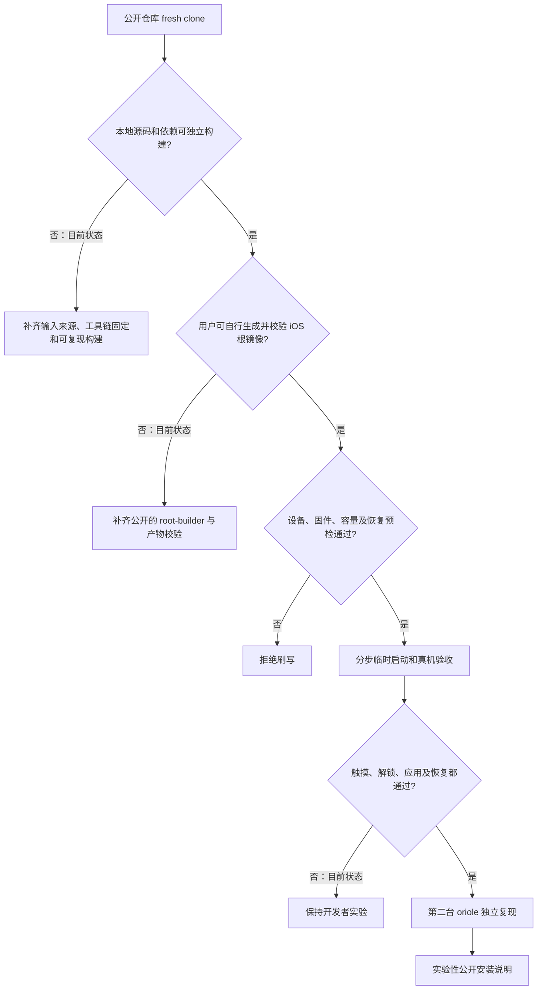

# 让其他人能安装：Pixel 6 公开复现与发行门槛

状态：**未开放安装**（2026-10-28 PDT）。本仓库在一台 Pixel 6 上通过临时启动到达 iOS 主屏；该主屏由测试用软件 Home 事件触发，实体上滑和应用点按仍未通过验收。这只证明该实验配置的显示路径，不构成可复现的公开安装流程。[真机证据](PIXEL6-IOS-HOMESCREEN.md)与本清单须分开阅读。

## 目前的硬阻塞

| 门槛 | 仓库现状（读源码/文件） | 需要交付并验证的结果 |
|---|---|---|
| 从零构建 | `tools/build-oriole-fbsnap-local.sh` 引用忽略的 `private/fbsnap-work/`、对象归档、ADT 和 `artifacts/` 配方；固定 SHA-256 是安全门禁，不能随意去掉。 | 提供有来源、版本和校验的输入获取/自行构建方法；在全新机器上无作者私有目录完成构建，并与真机验收产物比对。需要区分全源码编译和当前对象 relink。 |
| iOS 根镜像 | 当前可运行的 HFSX 根镜像不在仓库。嵌套 README 曾引用 `research/pixelios-kernel/tools/build-ios-root.sh`，但该脚本在本仓库不存在；单独的 [pixelios-userland](https://github.com/PixOS-Project/pixelios-userland) 项目有构建器，尚未在本仓库形成经 Pixel 6 验证的一体化流程。 | 纳入经许可审查的公开构建配方，用户自行提供并校验所需 iOS 16.7.16 输入；生成器验证产品/build、文件系统格式、分区容量与最终哈希。不得把 Apple 根镜像当作仓库附件。 |
| 设备预检与安装器 | 单机试验已有 `tools/preflight_oriole_touch_gui.py`：只读校验固定的本地镜像哈希、唯一已记录设备、`product=oriole`、解锁状态、私有固件基线、槽位和分区容量。它已用于 0127 真机临时启动前检查，但绑定作者的私有镜像和设备记录，不是面向陌生设备的安装器。 | 扩展为公开的只读预检与 dry-run：可审查的固件允许列表、自建镜像 provenance、充电/连接状态；任何未知值都停止。把清空 `userdata` 与 `fastboot boot` 分成两个明确步骤。 |
| 实体交互与稳定性 | 当前已观察到的主屏依赖测试用软件 Home 事件；`sweetfbsnap=1` 也是诊断开关。0118 短时诊断验证了实体触摸坐标和 HID 报告；0127 完整 iOS 启动验证了锁屏显示，但缺少同步实体手势结果。应用启动和长时间运行未验证。 | 用无合成输入的配置验证锁屏到主屏、触摸坐标/多点/按键、打开一个系统应用；再测重复启动、内存压力、温度、电池与异常恢复。不要把诊断配置发布为日用配置。 |
| 自动启动 | 当前 iOS 仍靠已核实设备上的临时 `fastboot boot`；普通重启可能落入 Android Recovery。仓库内的设备操作规则禁止写 `boot*`、`vbmeta`、`dtbo` 等启动分区。 | 在允许的安全边界内设计、审查和验证可重复的启动方案，说明断电、异常与回退行为；现阶段不能把一次临时启动描述为自动进入 iOS。 |
| 互联网 | USB gadget 可以把日志送到 Mac；0126 真机日志显示 `configd` 删除默认路由和 `ue0` 地址，0127 观察器再次记录删除标记。没有外网 IP、DNS 或系统 App 请求成功证据。 | 先确认设备地址/路由/网络服务，再验证主机受限 DHCP、NAT、DNS 和一项真实系统 App 请求；保留拔线恢复与接口身份核验。 |
| 恢复路径 | `userdata` 为 iOS 时 Android Recovery 报无法加载 Android。当前试验自动返回 Recovery，并没有验证面向陌生设备的一套完整恢复流程。 | 对支持的固件逐台确认官方恢复材料、版本/防回滚条件和数据清空范围；写出从 panic、Recovery、fastboot 返回可启动 Android 的实测步骤，并由非作者操作一次。 |
| 发行与支持范围 | 只在一台 Pixel 6 的一个固件基线上验证；没有跨设备版本矩阵或公开产物发布策略。 | 在第二台 `oriole` 与 fresh clone 主机上独立复现，发布兼容矩阵、源码/镜像 provenance、已知故障、卸载流程和更新策略；标明仍不支持的设备与功能。 |

这些是**可核对的工程门槛**，不是时间预估。真正的首个公开版本可定义为：独立用户从空白工作目录取得源码和所需工具，自备合法获取的 Apple 输入，生成并校验根镜像；只读预检通过后才按分步说明操作设备；真机能用实体输入进入主屏、打开一个应用，并能按验证过的流程恢复 Android。若任一项未通过，仍应标为开发者实验。

## 建议实施顺序

1. **让公开仓库自洽。** 清理失效的构建入口与本机绝对路径；固定依赖版本、下载来源和校验值；在干净 macOS/Linux 主机复现门禁和 XNU/ADT/临时启动镜像构建。当前 `tools/xnu-local-build` 是另一条 Linux 全源码构建路径，不能因它存在就声称已复现这次 Pixel 6 镜像。
2. **开放用户态构建配方。** 把所需 root-builder 以可审查源码和锁定依赖纳入仓库，明确 iPhone X / iOS 16.7.16 / 20H392 的输入校验、生成结果和容量边界。建立离线文件系统检查与失败时不产出可刷镜像的规则。
3. **完成安装前只读工具。** 只读采集设备状态并生成报告；公开安装说明基于实测允许列表，不靠“同为 Pixel 6”放行。先实现 dry-run 和负例测试，再考虑交互式刷写。
4. **先解决交互，再开放设备试用。** 在现有手机上去掉软件 Home 事件，验证实体触摸、应用启动和至少两轮可重复临时启动；记录 USB 日志与屏幕证据，不把启动 logo 当作成功。
5. **独立恢复与第二台设备。** 在不会保留私人数据的测试机上演练恢复 Android，再请另一位开发者按公开文档从零走通。通过后再发布“实验性安装”指南；是否提供二进制需先核对所有组成部分的分发许可。

## 已知操作边界

Pixel 6 的 `userdata` 一旦换成 iOS 根镜像，原 Android 用户数据即被清空；仅运行临时 `fastboot boot` 不会写启动分区。Google 的[官方 Pixel 工厂镜像说明](https://developers.google.com/android/images)明确提示解锁和安装工厂镜像会清除数据，并列有 Pixel 6 系列相关的防回滚说明；恢复方案必须针对设备当前版本核对，不能照抄旧固件命令。`adb`/`fastboot` 应从 [Google 官方 Platform-Tools](https://developer.android.com/tools/releases/platform-tools)取得。Apple 的[官方说明](https://support.apple.com/en-us/127113)确认 iOS 16.7.16 对 iPhone X 可用；这不是在 Pixel 6 上运行的兼容性保证。

本路线图没有授权向设备执行新的刷写，也不建议公开分发 Apple 镜像、设备原始日志、私有密钥或带个人内容的屏幕采样。根卷生产、硬件预检、写入和恢复都需要各自可检查的产物与真机结果。
